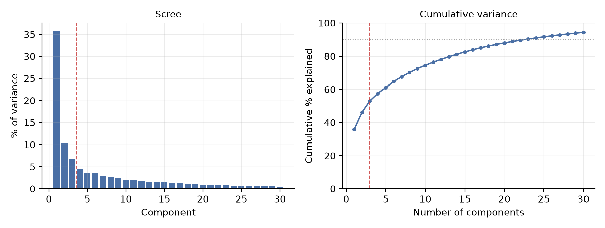
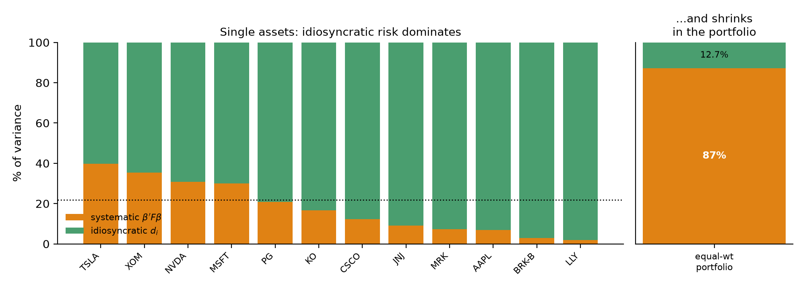

# Why We Need Factor Models

## Where Week 08 Left Off

Week 07 covered CAPM, APT, and the Fama French family.

Week 08 used those factors to attribute realized risk and return.

Both times the factors were handed to us. This week we build them.

::: {.notes}
The reason is not elegance. The sample covariance matrix stops working once
the number of assets gets close to the length of the series. Week 08 Problem 1
got away with a sample covariance because T was much larger than n. This week
drops that assumption.
:::

## Counting Parameters

A covariance matrix for $n$ assets has

$$
\frac{n(n+1)}{2}
$$

free parameters.

For $n = 100$ that is 5,050 numbers.

## The Data We Have

The 100 largest stocks in SPY, $T = 60$ days, 8 July to 30 September 2026.

5,050 parameters from 6,000 data points.

::: {.notes}
Files in Week09/data, rebuilt by get_data.py. Prices from Yahoo Finance, factors
from Ken French, constituents and float adjusted market caps from State
Street's SPY holdings file. The window ends where the Fama French file ends.
:::

## What Actually Breaks

| $n$ | $T$ | Parameters | Rank of $\widehat{\Sigma}$ | $\lambda_{\min}$ | Non-zero columns in $L$ |
|--:|--:|--:|--:|--:|--:|
| 100 | 60 | 5,050 | 59 | $\sim -10^{-18}$ | 59 of 100 |

: Sample covariance of 100 stocks from 60 daily observations

## A Certainty, Not an Error

The rank is $\min(T-1, n) = 59$.

A sum of $T$ rank-one outer products cannot have rank greater than $T$.
Centering the data costs one more.

With $n > T$ the sample covariance is always singular.

## What Did Not Break

The PD Cholesky fails.

The Week 03 PSD Cholesky, `chol_psd!` in the course library, does not. It
returns a root with 41 zero columns and reproduces $\widehat{\Sigma} = LL'$ to
$9.9 \times 10^{-16}$.

The Week 03 PCA simulation works too. Simulate from 59 draws instead of 100.

We can factor the matrix and simulate from it. That is the problem.

::: {.notes}
Of the 41 zero columns, 38 are exactly zero. The other 3 come from pivots that
rounding pushed slightly positive, and they survive at around 1e-8, six orders
of magnitude below the real columns. Code: week09_01_singular_covariance.jl.
:::

## Every Scenario Is a Day We Have Seen

$L$ has rank 59. Every simulated $r = Lz$ lies in a 59 dimensional subspace of
$\mathbb{R}^{100}$.

That subspace is the span of the 60 demeaned historical observations.

There is no information in the estimate about the other 41 directions.

## Not Silent. Wrong.

The matrix does not say "unknown" about those 41 directions.

It says they have exactly zero variance.

## A Riskless Portfolio

Estimate on the first 30 days. The null space is now 71 dimensional.

Pick a portfolio in it with weights summing to 1. Max weight 5.4%, gross 1.5x.
Ordinary looking.

| | Value |
|:--|--:|
| Forecast volatility (in-sample) | 0% to numerical precision |
| Realized volatility, same 30 days | $\sim10^{-14}$% |
| Realized volatility, next 30 days | 6.82% |
| FF3 factor model forecast, same portfolio | 7.38% |

: {tbl-colwidths="[70,30]"}

## Internally Consistent

The estimate calls the portfolio riskless, and in sample it is.

Out of sample it runs at 6.8%.

The factor model never assigns zero risk to anything. It said 7.38%.

## The Optimizer Finds It

Minimum variance on all 60 days, with a pseudo-inverse. The answer depends on
the cutoff for "zero."

Default tolerance: 6.2% long to 5.1% short, 2.23x gross.

Keep the $10^{-18}$ rounding noise: 49% in one name, 7.35x gross.

The true minimum under the sample matrix is zero. The optimizer finds whatever
the estimate, or your cutoff, says is riskless.

## Way Out 1: Repair the Matrix

Week 03: Rebonato and Jackel, Higham, PSD Cholesky, PCA.

None of them adds information.

They fix a matrix that is nearly good and was corrupted by floating point error
or missing data. A numerical problem with a numerical fix.

## Ours Is Not Numerical

Raise 41 zero eigenvalues to some small positive number and you can invert the
matrix.

The directions are arbitrary. The risk along them is whatever you picked when
you patched it.

You have converted "I know nothing here" into a specific number.

## Way Out 2: Change the Model

If returns are driven by a small number of common factors,

$$
\Sigma = BFB' + D
$$

406 parameters instead of 5,050. Full rank and invertible for any $T$.

The rank comes from the structure, not from a patch.

## The Trade

Every asset gets its own strictly positive specific variance. No portfolio is
ever called riskless.

We buy conditioning, tractability, and interpretable exposures with a structural
assumption.

If the assumption is wrong we get a well behaved matrix that is confidently
incorrect.

# The General Linear Factor Model

## One Asset, One Date

$$
r_{i,t} = \alpha_i + \sum_{k=1}^{m} \beta_{i,k} f_{k,t} + \varepsilon_{i,t}
$$

## The Cross-Section

$$
r_t = \alpha + B f_t + \varepsilon_t
$$

$r_t$ is $n\times 1$, $B$ is $n \times m$, $f_t$ is $m \times 1$.

Stack all $T$ dates:

$$
R = \mathbf{1}\alpha' + F B' + E
$$

## Three Things Called "The Factor"

| Term | Symbol | Dim. | What it is |
|:--|:--|:--|:--|
| Exposure / loading / beta | $B$ | $n\times m$ | how much of factor $k$ asset $i$ carries |
| Factor return | $f_t$ | $m\times 1$ | what the factor did in period $t$ |
| Factor premium | $E[f]$ | $m\times 1$ | long run expected reward for the exposure |

: {tbl-colwidths="[30,12,12,46]"}

## Keep Them Straight

"Apple has a high momentum beta." A statement about $B$.

"Momentum was up 40bp yesterday." A statement about $f_t$.

"Momentum earns 3% a year." A statement about $E[f]$.

Only the last is an asset pricing claim. The first two are risk statements.

## Assumption 1

$$
E[\varepsilon_{i,t}] = 0
$$

The residual has no drift.

Anything systematic left in the residual becomes $\alpha$. And $\alpha$ is
either skill or a missing factor.

## Assumption 2

$$
\operatorname{cov}(f_{k,t}, \varepsilon_{i,t}) = 0
$$

In a time series model fit by OLS this holds in sample by construction. It is a
property of the residual, not a testable claim.

Out of sample it is a real assumption.

## Assumption 3

$$
\operatorname{cov}(\varepsilon_{i,t}, \varepsilon_{j,t}) = 0 \quad i \neq j
$$

The residual covariance $D$ is diagonal.

This is the load bearing assumption. It collapses the parameter count, and it is
the one most often false.

## Everything Follows From This Line

$$
\Sigma = \operatorname{cov}(r) = B\,\operatorname{cov}(f)\,B' + \operatorname{cov}(\varepsilon) = BFB' + D
$$

with $F = \operatorname{cov}(f)$ and $D = \operatorname{diag}(d_1,\dots,d_n)$.

# Three Ways to Build a Factor Model

## Two Unknowns

$R = FB' + E$ has two unknowns on the right.

Which one you treat as observed determines the type of model and the direction
of the regression.

## What Is Observed

{width=95%}

## The Three Types

| | Observed | Estimated | Regression | Examples |
|:--|:--|:--|:--|:--|
| Time-series | $f$ | $B$ | one per asset, over time | Fama French, Carhart, macro |
| Cross-sectional | $B$ | $f$ | one per date, across assets | BARRA, Axioma, Fama MacBeth |
| Statistical | neither | both | eigendecomposition | PCA, factor analysis |

: {tbl-colwidths="[18,12,12,28,30]"}

## No Correct Choice

**Time-series.** The factors are economically meaningful and observable.
Market, rates, oil, the published FF portfolios. Best for attribution against a
standard.

**Cross-sectional.** Good firm characteristics and a large, changing universe.
What the commercial risk vendors sell.

**Statistical.** The risk structure with no priors, or a diagnostic on the other
two.

# Time-Series Models

## OLS, All At Once

The factor returns are given. OLS once per asset, but every asset shares the
same right hand side.

$X = [\mathbf{1} \;\; F]$, $T \times (m+1)$:

$$
\widehat{\Theta} = (X'X)^{-1}X'R
\qquad
\widehat{\alpha} = \widehat{\Theta}_{1,\cdot}\,,\quad
\widehat{B}' = \widehat{\Theta}_{2:m+1,\cdot}
$$

One $(m+1)\times(m+1)$ inverse serves all $n$ assets.

## Specific Variances

$E = R - X\widehat{\Theta}$ and

$$
\hat{d}_i = \frac{1}{T-m-1}\sum_{t=1}^{T}E_{t,i}^2
$$

With $T = 60$ and $m = 3$, divide by 56, not 60.

Ignoring that biases every specific variance down by 7%, and the whole risk
model with it.

## FF3 on Our Data {.smaller}

| | TSLA | MSFT | NVDA | CSCO | AAPL | BRK-B | JNJ | XOM |
|:--|--:|--:|--:|--:|--:|--:|--:|--:|
| $\beta_{\text{Mkt}}$ | 2.560 | 1.613 | 1.549 | 0.862 | 0.473 | 0.079 | 0.032 | -0.695 |
| $\beta_{\text{SMB}}$ | -0.315 | -0.907 | -0.539 | -0.805 | 0.476 | 0.112 | 0.097 | -0.841 |
| $\beta_{\text{HML}}$ | -0.410 | -0.609 | -0.712 | -0.219 | 0.777 | 0.278 | 0.623 | 0.624 |
| $R^2$ | 0.40 | 0.30 | 0.31 | 0.12 | 0.07 | 0.03 | 0.09 | 0.35 |
| Ann. $\sigma$ | 50.4% | 41.3% | 40.3% | 34.6% | 28.1% | 14.7% | 20.7% | 26.0% |

: FF3 betas, selected stocks, 60 daily observations

## Read the Signs

HML is sensible. TSLA, MSFT, NVDA negative, growth names. XOM and JNJ positive.

XOM has a market beta of -0.70. The market was driven by technology. Energy went
its own way.

AAPL, BRK-B, JNJ: $R^2$ below 0.10. Sixty days describe sixty days, not the
company.

## 20%

Across all 100 stocks the mean $R^2$ is 0.205.

From 0.003 (RTX) to 0.548 (COF).

Three factors explain about 20% of a typical stock's daily variance. Hold on to
that number.

## Full Sample or Rolling

**Full sample.** Equal weight on every observation. Lowest estimation error.
Assumes beta is constant over the window.

**Rolling or exponentially weighted.** Tracks changing exposure at the cost of
noisier estimates.

## The Cost of a Short Window

$$
\operatorname{se}(\hat\beta_k) \approx \frac{\sigma_\varepsilon}{\sigma_{f_k}\sqrt{T}}
$$

Halving the window multiplies the standard error by $\sqrt{2}$.

Our median market beta standard error is already 0.36. A rolling 20 day beta
on daily data is mostly noise.

## My Opinion

On daily data, use at least a year.

If you need faster adaptation, use exponential weighting rather than a short
window.

You keep the effective sample size and still down-weight the past.

# Cross-Sectional Models

## Invert the Problem

Observe the betas. Estimate the factor returns.

The betas come from firm characteristics:

- Industry or sector membership, as 0/1 dummies
- Size, $\log(\text{market cap})$
- Value, book to price or earnings to price
- Leverage, profitability, trading activity, historical volatility

## Descriptors

Observable today, for every stock, with no regression.

A newly listed stock has a book to price ratio on day one.

It has no beta until you have a return history.

## Standardize

$\log(\text{cap})$ is around 25. Book to price is around 0.3.

Standardize cross-sectionally at each date:

$$
z_{i,k} = \frac{x_{i,k} - \bar{x}_k}{s_k}
$$

A factor return is then the return to one unit of standardized exposure.

## Winsorize

Clip at roughly $\pm 3$.

One stock with a book to price of 40, because its book value is an accounting
artifact, will otherwise run the entire regression for that day.

## One Regression Per Date

$$
r_t = B f_t + \varepsilon_t
\qquad\Longrightarrow\qquad
\hat{f}_t = (B'WB)^{-1}B'W r_t
$$

$n$ observations, $m$ regressors. The opposite orientation from the time series
case.

Repeat over $T$ dates for a time series of factor returns.

## The Weighting Matrix

$W = D^{-1}$, inverse specific variance. GLS, efficient if $D$ is known.

$W = \operatorname{diag}(\sqrt{\text{mktcap}})$. A common vendor choice. Damps
small illiquid names without letting the mega caps run the regression.

GLS needs $D$, which needs residuals, which needs the regression. Iterate: OLS,
estimate $D$, re-run as GLS.

## Factor Returns Are Portfolio Returns

$$
\hat{f}_t = \underbrace{(B'WB)^{-1}B'W}_{\textstyle \Omega,\ \ m\times n} \, r_t
$$

$\Omega$ does not depend on $r_t$.

$$
\hat{f}_{k,t} = \sum_{i=1}^{n} \Omega_{k,i}\, r_{i,t}
$$

Each row of $\Omega$ is a portfolio. These are factor mimicking portfolios.

## Three Consequences

1. The estimated factor returns are achievable. You can hold the portfolio.
2. $\Omega B = I$. Unit exposure to factor $k$, zero to every other. Purified in
   a way Fama French is not. HML has a well known negative market beta.
3. A hedge. Short the mimicking portfolio to neutralize an unwanted exposure.

## Identification

A market column of ones plus a full set of industry dummies.

The dummies sum to the market column. $B$ is rank deficient. $(B'WB)^{-1}$ does
not exist.

Force the industry factor returns to sum to zero:

$$
\sum_{k \in \text{industries}} c_k f_{k,t} = 0
$$

## Solve Through KKT

$$
\begin{bmatrix} B'WB & C' \\ C & 0 \end{bmatrix}
\begin{bmatrix} f_t \\ \lambda \end{bmatrix}
=
\begin{bmatrix} B'W r_t \\ 0 \end{bmatrix}
$$

$C = [\,0 \;\; c_1 \;\cdots\; c_K\,]$: a zero for the market, $c_k$ for each
industry.

## Three Constraints {.smaller}

The $c$ weighted average industry factor is zero. Each industry is measured
against an "average industry," and $c$ defines average.

| Name | $c_k$ | Each industry counts | Industries measured against |
|:--|:--|:--|:--|
| Equal | 1 | once, whatever its size | the average industry |
| Count | $n_k$, stocks in industry $k$ | by how many stocks it holds | the average stock |
| Cap | industry $k$'s share of market cap | by its market value | the average dollar |

: {tbl-colwidths="[10,32,26,32]"}

28 Tech stocks, 7 Staples. Equal: they count the same. Count: Tech counts 4x.
Cap: 43.8% against 5.1%, more than 8x. Our model uses equal.

## The Constraint Is Not Cosmetic

It defines what "the market factor" means.

With the cap constraint and cap weights in $W$, the market factor return is the
cap weighted market return and the industries are pure relative effects.

Change the constraint and you change the interpretation of every factor.

## Choosing $W$

$W$ sets how much each stock counts in the daily regression.

It also sets what the factors are. Every factor return is a portfolio return
through $\Omega = (B'WB)^{-1}B'W$.

A different $W$ is a different set of portfolios.

## Four Choices {.smaller}

| $W$ | Market factor tracks | Efficiency | Needs | Main weakness |
|:--|:--|:--|:--|:--|
| $I$ (OLS) | equal weighted stocks | low | returns only | small caps dominate |
| $D^{-1}$ (GLS) | a low specific risk tilt | highest, if $D$ is right | a first pass for $D$ | not an index, inherits error in $D$ |
| mktcap | the cap weighted index | low | market caps | mega caps dominate the factors |
| $\sqrt{\text{mktcap}}$ | close to the cap weighted index | middle | market caps | only approximately the index |

: Market factor column: count constraint with $I$, cap constraint with the cap based weights {tbl-colwidths="[14,24,18,18,26]"}

## GLS on Our Data

The market factor's largest weights: PEP 3.3%, HD 3.3%, DIS 2.7%. None is
above 0.7% of the cap weighted index.

AAPL is 10.7% of the index and gets 0.4%. SNDK gets 0.08%.

That is a low volatility portfolio, not an index.

## Cap Weights Cut Both Ways

**Cap.** The market factor is the index. Factor returns reconcile to the
benchmark.

But the mega caps run the regression. An industry factor becomes its two or
three largest names, stock specific news included.

**Square root of cap.** The vendor compromise. Damps small names without handing
the regression to five stocks.

## Which $W$

Against a cap weighted benchmark: $\sqrt{\text{mktcap}}$ with the cap
constraint.

For the cleanest factor returns: GLS.

Cap the largest weights either way. And state the choice. Factor returns from
different $W$ are not comparable.

## The Market Factor Is a Portfolio

Market column plus industry dummies, diagonal $W$. The fit for industry $g$ is
the $W$ weighted industry average:

$$
\hat{f}_{\text{mkt},t} + \hat{f}_{g,t} = m_{g,t} = \frac{\sum_{i \in g} W_{ii}\, r_{i,t}}{\sum_{i \in g} W_{ii}}
$$

The constraint makes the market factor the $c$ weighted average of those:

$$
\hat{f}_{\text{mkt},t} = \sum_k \tilde{c}_k\, m_{k,t},
\qquad \tilde{c}_k = \frac{c_k}{\sum_j c_j}
$$

## Across and Within

$$
\omega_i = \tilde{c}_{g(i)}\,\frac{W_{ii}}{\sum_{j \in g(i)} W_{jj}}
$$

The constraint sets the weight across industries. $W$ sets it within each one.

- mktcap, cap constraint: exactly the cap weighted index
- $I$, count constraint: exactly the equal weighted index
- $D^{-1}$, equal constraint, ours: one eighth per industry, quiet names favored

## What It Does to $\hat{f}_{\text{mkt}}$ {.smaller}

| $W$ | Constraint | Ann. vol | Corr, cap 100 | Beta, cap 100 | TE vs cap 100 | TE vs SPY |
|:--|:--|--:|--:|--:|--:|--:|
| $I$ | Equal | 8.7% | 0.737 | 0.527 | 8.20% | 7.27% |
| $I$ | Count | 10.2% | 0.878 | 0.737 | 5.82% | 4.49% |
| $D^{-1}$ | Equal | 8.4% | 0.631 | 0.437 | 9.44% | 8.50% |
| $D^{-1}$ | Count | 9.5% | 0.837 | 0.653 | 6.67% | 5.30% |
| $D^{-1}$ | Cap | 12.2% | 0.873 | 0.877 | 6.12% | 4.75% |
| $\sqrt{\text{mktcap}}$ | Cap | 13.0% | 0.960 | 1.028 | 3.64% | 3.26% |
| mktcap | Cap | 12.1% | 1.000 | 1.000 | 0.00% | 2.55% |

: Cap 100: the cap weighted portfolio of our 100 stocks, 74.6% of SPY. {tbl-colwidths="[14,12,11,15,15,16,17]"}

The last row is the closed form: exactly the cap weighted 100.

## Ours Is the Furthest From the Index

$D^{-1}$, equal constraint: beta 0.44 to the cap weighted 100, 9.4% tracking
error.

Tech is 44% of the index and drove this window. Our market factor gives it one
eighth.

The constraint does most of the work. Equal to cap, holding $W = D^{-1}$: 9.4%
down to 6.1%.

$\sqrt{\text{mktcap}}$, cap constraint: 3.6%. AAPL 5.1% against a cap weight of
10.7%. The damping it was chosen for.

## The Constraint Changes the Name, Not the Risk

$B$ is rank deficient. Every constraint gives the same $B\hat{f}_t$, the same
residuals, the same $\Sigma$. The script confirms it to $10^{-18}$.

What moves is the split between market and industries. $F$ changes, and so does
every factor attribution.

$W$ is different. It changes the fit, and $\Sigma$ with it.

## Beta to the Cap Weighted Market

A market loading of 1 is not a beta of 1 to the index. With $x_m = B'w_m$:

$$
\beta_i = \frac{(\Sigma w_m)_i}{w_m'\Sigma w_m}
= \frac{b_i' F x_m + w_{m,i}\, d_i}{x_m' F x_m + \sum_j w_{m,j}^2\, d_j}
$$

Beta to the market factor instead:

$$
\beta_i^{f} = \frac{(F b_i)_{\text{mkt}}}{F_{\text{mkt},\text{mkt}}}
$$

The two agree only when the market factor is the cap weighted index.

## Two Betas, Two Answers {.smaller}

| Industry | Beta to market factor | Model beta to cap 100 | Historical beta to cap 100 |
|:--|--:|:--|:--|
| Tech | 0.58 | 1.39 to 2.43 | -0.14 to 3.68 |
| Discretionary | 1.65 | 0.38 to 0.91 | 0.03 to 2.56 |
| Industrials | 0.98 | 0.59 to 0.63 | -0.30 to 1.77 |
| Financials | 1.29 | 0.41 to 0.44 | -0.63 to 1.86 |
| Comm. Services | 1.42 | 0.14 to 0.45 | -0.01 to 1.43 |
| Health | 1.06 | -0.03 to 0.02 | -0.47 to 1.25 |
| Staples | 0.99 | -0.18 to -0.14 | -1.02 to 0.22 |
| Other | 0.02 | -0.19 to -0.17 | -0.91 to 1.46 |

: Our model, $D^{-1}$ and equal constraint. $w_m$ is the float adjusted cap weight. {tbl-colwidths="[22,22,28,28]"}

Staples: 0.99 to our market factor, -0.16 to the index. Hedge the index with the
third column, not the second.

## Same Industry, Same Beta

$b_i'Fx_m$ is identical inside an industry. Only $w_{m,i} d_i$ differs.

AAPL is the exception. 10.7% of the index, so the own weight term lifts its
model beta to 2.43. Historical: 0.21.

AAPL moved against the rest of Tech. It loads +1 on Tech, the misfit lands in
$d_i$, and its specific vol comes out at 45%, above its total vol of 28%.

The own weight term is only as good as $d_i$.

## The Fix Is a Style Factor

Vendors add a Beta style factor. The descriptor is a historical beta,
standardized like any other.

A time series estimate comes back into the model, as an observed exposure, not
as the market loading.

::: {.notes}
Code for this whole block of slides: the end of week09_04_cross_sectional.jl.
:::

## Fama MacBeth

$T$ estimates $\hat{f}_1,\dots,\hat{f}_T$:

$$
\bar{f}_k = \frac{1}{T}\sum_{t=1}^T \hat{f}_{k,t}
\qquad
t\text{-stat} = \frac{\bar{f}_k}{s(\hat{f}_k)/\sqrt{T}}
$$

## Why It Works

Residuals within one date are heavily correlated. Everything moves with the
market. Single-date standard errors are badly understated.

Estimates across dates are approximately independent, because daily returns are
approximately serially uncorrelated.

The dispersion over time gives valid inference. We never model the within-date
correlation.

If $\hat{f}_t$ is serially correlated, use Newey West.

## Market Plus 8 Industries {.smaller}

| Factor | Mean return (bp/day) | Ann. vol | FM $t$-stat |
|:--|--:|--:|--:|
| Market | -1.8 | 8.4% | -0.26 |
| Tech | +14.4 | 27.2% | +0.65 |
| Health | +13.4 | 14.7% | +1.13 |
| Comm. Services | +10.4 | 16.6% | +0.77 |
| Other | +3.5 | 13.8% | +0.32 |
| Financials | -5.6 | 9.8% | -0.71 |
| Staples | -5.7 | 14.2% | -0.50 |
| Industrials | -7.9 | 16.0% | -0.61 |
| Discretionary | -22.5 | 12.0% | -2.31 |

: OLS, then GLS with $W = D^{-1}$, sum to zero constraint {tbl-colwidths="[34,24,18,24]"}

::: {.notes}
Specific volatility from the OLS pass runs from 11.5% for PEP to 104.5% for
SNDK, so GLS gives PEP 82 times the weight of SNDK. Code:
week09_04_cross_sectional.jl.
:::

## One Clears 2.0. It Means Nothing.

Discretionary at -2.31.

Nine factors tested at 5%: chance alone gives 0.45 false positives on average.

Sixty days is far too short to say anything about factor premia.

The volatilities are estimated much more precisely than the means. Use this
model for risk. Do not use these means as expected returns.

# Statistical Models

## Week 03 PCA, New Purpose

Neither $B$ nor $f$ is observed. Extract both from the covariance matrix.

$$
\widehat{\Sigma} = S\Lambda S'
$$

Keep the largest $m$ eigenvalues:

$$
B = S_{[\cdot,1:m]}\,\Lambda_{[1:m]}^{1/2}, \qquad F = I_m
$$

## Specific Variance

The factors are principal components scaled to unit variance. $BFB' = BB'$.

The specific variances are what the components did not explain:

$$
d_i = \widehat{\Sigma}_{ii} - \sum_{k=1}^m B_{i,k}^2
$$

## Rotation Indeterminacy

For any orthogonal $m\times m$ matrix $Q$,

$$
B f = (BQ)(Q'f)
\qquad\text{and}\qquad
(BQ)(BQ)' = BQQ'B' = BB'
$$

Same fit, same covariance matrix.

Statistical factors are only identified up to rotation.

## PC1 Is Not the Market

PC1 is the direction of maximum variance.

For equity returns that is usually close to a market-like direction. The model
has no opinion about that.

This is where students most often go wrong.

## Check It After the Fact

On our window PC1 is not the market. 61% of loadings share a sign. Its return
has a 0.53 correlation with SPY.

Long semis and storage: SNDK, MU, MRVL, LRCX, INTC. Short software, services,
defensives: ACN, CRM, MO, ADP, BKNG.

PC2 is closer: 83% share a sign, 0.69 with SPY. Neither is the market.

PCA ranks by variance. It never promised the largest component has a name.

## Good for Risk, Awkward for Attribution

Risk depends only on $BB' + D$. Rotation invariant.

Attribution requires naming the factors.

## Choosing $m$

- **Scree plot.** Look for the elbow where the eigenvalues flatten into noise.
- **Cumulative variance.** Keep enough components to hit a target.
- **Information criteria.** Bai and Ng (2002), when both $n$ and $T$ are large.

$$
IC_{p1}(m) = \ln V(m) + m\left(\frac{n+T}{nT}\right)\ln\left(\frac{nT}{n+T}\right)
$$

$V(m)$ is the mean squared residual. Minimize over $m$.

## The Scree

{width=95%}

## The Elbow Is at 3

| Components | 1 | 2 | 3 | 5 | 10 | 20 | 59 |
|:--|--:|--:|--:|--:|--:|--:|--:|
| Cumulative variance | 35.7% | 46.1% | 53.0% | 61.1% | 74.5% | 88.1% | 100.0% |

: {tbl-colwidths="[30,10,10,10,10,10,10,10]"}

35.7%, then 10.4%, then 6.9%. A gradual drop-off after that, typical for equity
returns.

A 90% rule demands more than 20 factors. That is overfitting 60 observations.

The eigenvalues run out at 59. The rank problem again.

## Asymptotic PCA When $n > T$

Connor and Korajczyk (1986). Work with the $T \times T$ matrix:

$$
\Omega = \frac{1}{n}\tilde{R}\tilde{R}' \quad (T\times T)
$$

Same non-zero eigenvalues. The eigenvectors are the factor realizations. Regress
returns on them for the loadings.

$O(T^3)$ instead of $O(n^3)$. For 3,000 stocks on 250 days, a factor of 1,700.

## Correlation or Covariance

They give different answers.

Covariance PCA is dominated by the high variance names. TSLA at 50% against JNJ
at 21% gets roughly 6 times the influence on PC1.

Correlation PCA treats every asset equally.

## My Opinion

For a risk model use covariance. You care about dollars of risk, and the high
volatility names genuinely matter more.

For exploratory structure finding use correlation, so a few volatile names do not
dictate the answer.

# The Factor Covariance Matrix

## The Structure

{width=95%}

## Parameter Count

$$
\underbrace{nm}_{B}\;+\;\underbrace{\frac{m(m+1)}{2}}_{F}\;+\;\underbrace{n}_{D}
\;=\; 300 + 6 + 100 \;=\; 406
$$

against $n(n+1)/2 = 5{,}050$. A 12 fold reduction.

More important, linear in $n$ rather than quadratic. Doubling the universe
doubles the parameters instead of quadrupling them.

## PSD for Free

If $F$ is PSD and every $d_i \geq 0$, $\Sigma$ is PSD. Let $y = B'x$:

$$
x'\Sigma x = y'Fy + \sum_{i=1}^n d_i x_i^2
$$

Both terms are $\geq 0$. If every $d_i > 0$ the second is strictly positive for
$x \neq 0$. $\blacksquare$

## Compare to Week 03

There we estimated a matrix, found it was not PSD, and repaired it.

Here the question never comes up.

The factor structure is a parameterization of the PSD cone. No choice of $B$ can
leave it.

## The One Thing to Check

In a statistical model $d_i = \Sigma_{ii} - \sum_k B_{ik}^2$ can go negative if
the components over-explain an asset.

A Heywood case. Floor it at a small positive number.

Our minimum $d_i$ from the 3 component model is $6.12\times10^{-5}$. No flooring
needed.

## $D$ Does the Structural Work

$\operatorname{rank}(BFB') = m$. Rank 3 out of 100.

Adding a strictly positive $D$ fixes it:

$$
\lambda_{\min}(\Sigma) \geq \min_i d_i
$$

Students think of $D$ as leftover junk. It is what makes the matrix invertible.

## No Riskless Portfolio

Neutralize all $m$ factor exposures and what is left is

$$
w'\Sigma w = \sum_i w_i^2 d_i > 0
$$

The model never calls a portfolio riskless because it never claims certainty
about a single stock.

## Three Estimates Compared

| | Sample | FF3 factor model | PCA-3 model |
|:--|--:|--:|--:|
| Rank | 59 | 100 | 100 |
| $\lambda_{\min}$ | $\sim -10^{-18}$ | $6.92\times10^{-5}$ | $6.14\times10^{-5}$ |
| Condition number | undefined | 178 | 373 |
| Non-zero columns in $L$ | 59 of 100 | 100 | 100 |
| Parameters | 5,050 | 406 | 406 |

: {tbl-colwidths="[34,22,22,22]"}

## Undefined, Not Large

Condition numbers of 178 and 373 are well behaved matrices.

For the sample estimate $\lambda_{\min}$ is zero. Whatever your software prints
is a report on rounding.

Values above $10^{13}$ are typical, and the figure changes with the LAPACK path.

## Woodbury

$$
(D + BFB')^{-1} = D^{-1} - D^{-1}B\left(F^{-1} + B'D^{-1}B\right)^{-1}B'D^{-1}
$$

$D^{-1}$ is $n$ divisions. $F^{-1}$ and $B'D^{-1}B$ are $m\times m$.

The only real inverse is $m\times m$. $O(nm^2)$ instead of $O(n^3)$.

## It Barely Grows

| $n$ | 100 | 500 | 1,000 | 2,000 | 5,000 |
|:--|--:|--:|--:|--:|--:|
| Direct (ms) | 0.037 | 6.11 | 11.9 | 43.2 | 410 |
| Woodbury (ms) | 0.002 | 0.006 | 0.011 | 0.036 | 0.080 |
| Speedup | 22x | 1,019x | 1,111x | 1,191x | 5,130x |

: Maximum relative difference $7.4\times10^{-16}$. Timings vary by machine. {tbl-colwidths="[25,15,15,15,15,15]"}

Direct grows by about 11,000x from 100 to 5,000 names. Woodbury stays under a
tenth of a millisecond.

## Never Form $\Sigma$

Commercial optimizers store the covariance in factor form and never build
$\Sigma$ at all.

An $8{,}000\times8{,}000$ dense matrix is 512MB.

The factor form is about 0.3MB.

## Shrinkage

Ledoit and Wolf: a convex combination of the sample and a structured target.

$$
\Sigma_{\text{shrunk}} = \delta\, T_{\text{target}} + (1-\delta)\,\widehat{\Sigma}_{\text{sample}}
$$

$\delta$ minimizes expected squared error. Common targets are a scaled identity
or the constant correlation matrix.

## Two Routes {.smaller}

| | Factor model | Shrinkage |
|:--|:--|:--|
| Assumption | returns driven by $m$ common factors | none structural, target is a bias/variance device |
| Well conditioned | yes, by construction | yes, for $\delta > 0$ |
| Gives exposures | yes | no |
| Supports attribution | yes | no |
| Fast inverse | yes, Woodbury | no, dense |
| Fails when | the factors are wrong | never badly, but never great |
| Parameters | $O(nm)$ | $O(n^2)$, regularized |

: {tbl-colwidths="[24,38,38]"}

## Closer Than They Look

Ledoit and Wolf's 2003 target was the single index model. A one factor model.

A factor model is the $\delta = 1$ corner. Full commitment to the structure.

Practitioners shrink the sample toward the factor model rather than choose.

## My Opinion

If all you need is a number for portfolio volatility, shrinkage is simpler and
hard to beat.

If you need to answer why the risk is that number, or what happens if the market
rallies 2%, you need a factor model.

Shrinkage answers neither question.

# Systematic and Idiosyncratic Risk

## Two Pieces

$$
\sigma_i^2 = \underbrace{\beta_i' F \beta_i}_{\text{systematic}} + \underbrace{d_i}_{\text{idiosyncratic}}
$$

The systematic share is the regression $R^2$:

$$
R_i^2 = \frac{\beta_i' F \beta_i}{\beta_i' F \beta_i + d_i}
$$

## For a Portfolio

Portfolio exposure vector $x = B'w$, $m\times 1$.

$$
\sigma_p^2 = \underbrace{x'Fx}_{\text{systematic}} + \underbrace{\sum_{i=1}^n w_i^2 d_i}_{\text{idiosyncratic}}
$$

## Diversification, Precisely

Equal weights, $w_i = 1/n$:

$$
\sum_{i=1}^n \frac{1}{n^2}d_i = \frac{1}{n}\bar{d} \;\longrightarrow\; 0
$$

Idiosyncratic variance falls at rate $1/n$. The systematic term $x'Fx$ does not
fall at all.

## Asset Against Portfolio

{width=100%}

## The Numbers

| | Typical single stock | AAPL alone | Equal-weighted 100 stocks |
|:--|--:|--:|--:|
| Systematic share | 20.5% | 6.9% | 87.3% |
| Idiosyncratic share | 79.5% | 93.1% | 12.7% |

: {tbl-colwidths="[28,24,24,24]"}

## Poor for a Stock, Good for a Portfolio

Three factors explain about a fifth of one stock.

They explain 87% of a portfolio of the same 100 stocks. Specific variance is
large in this window, so 13% survives, down from four fifths.

It is also why diagonal $D$ is more forgivable than it looks. Errors in $D$ get
multiplied by $w_i^2$.

## In Volatility Terms

$$
10.10\% = \sqrt{(9.43\%)^2 + (3.60\%)^2}
$$

Risk adds in quadrature.

The idiosyncratic piece is more than a third the size. It adds 0.67 points.

# Ex-Ante Risk

## Exposure Space

$x = B'w$ reduces 100 weights to 3 numbers.

| | Mkt-RF | SMB | HML |
|:--|--:|--:|--:|
| Exposure $x = B'w$ | 0.852 | +0.089 | +0.099 |
| Share of portfolio variance | 90.5% | 1.0% | -4.3% |

: Equal-weight portfolio {tbl-colwidths="[40,20,20,20]"}

A portfolio manager can hold three numbers in their head. Not 100 weights and a
$100\times100$ correlation matrix.

## Negative Shares Again

$$
\frac{\partial \sigma_p^2}{\partial x_k} = 2(Fx)_k
\qquad\Rightarrow\qquad
\text{share}_k = \frac{x_k (Fx)_k}{\sigma_p^2}
$$

HML moved against the market, $-0.51$. The portfolio is long HML, so the tilt
offsets some market risk. That is the point of hedging.

SMB barely moved with the market, $+0.10$. Its share is about 1%.

Idiosyncratic risk takes the remaining 12.7%.

## Week 08, Ex-Ante

The same Euler decomposition:

$$
\sigma_p = \sum_{k=1}^m \frac{x_k (Fx)_k}{\sigma_p} + \frac{\sum_i w_i^2 d_i}{\sigma_p}
$$

Exact.

No regression this time. We have $B$ and $F$ directly.

## Simulation in $n$ Dimensions

Week 05 simulated joint distributions with copulas.

A Gaussian copula on 100 series needs a $100\times100$ correlation matrix.

We know how that ends with 60 observations.

## Simulate Through the Factors

{width=95%}

## The Steps

For each of $S$ scenarios:

1. Draw $f^{(s)}$ from the joint factor distribution. $m$ dimensions.
2. Draw $n$ independent $\varepsilon_i^{(s)}$. $D$ is diagonal, so no copula.
3. Form $r^{(s)} = \alpha + Bf^{(s)} + \varepsilon^{(s)}$.
4. Compute $P^{(s)} = w'r^{(s)}$.
5. Empirical quantile for VaR, tail mean for ES, as in Week 05.

## What It Buys

The copula is fit on 3 series with 60 observations. On 100 it is not feasible.

Fat tails go where they belong. A $t$ on each of 100 stocks conflates market tail
risk with single name event risk.

Give the market a $t_5$ and leave the idiosyncratic terms normal. Closer to what
happens.

Factor VaR is free. Shock one factor, hold the rest at zero.

## Under Normality

Equal weight portfolio, daily volatility 0.632%.

$$
\text{VaR}_{5\%} = 1.645 \times 0.632\% = 1.040\%
$$

$$
\text{ES}_{5\%} = \frac{\phi(z_{0.05})}{0.05}\times 0.632\% = 1.304\%
$$

A $t_5$ market factor pushes both out, ES in particular. That is Problem 2.

## Tracking Error

Benchmark weights $b$, active weights $a = w - b$:

$$
TE = \sqrt{\underbrace{(B'a)'F(B'a)}_{\text{factor bets}} + \underbrace{\textstyle\sum_i a_i^2 d_i}_{\text{stock selection}}}
$$

Two very different activities, separated.

## Equal Weight Against Cap Weight

Benchmark: the same 100 stocks at float adjusted cap weights.

| Total TE | Factor bets | Stock selection | Active Mkt-RF | Active SMB | Active HML |
|--:|--:|--:|--:|--:|--:|
| 6.29% | 3.34% | 5.33% | $-0.150$ | $+0.261$ | $+0.174$ |

: Annualized {tbl-colwidths="[16,16,18,16,17,17]"}

$\sqrt{3.34^2 + 5.33^2} = 6.29$.

## What the Table Says

Equal weight underweights AAPL, NVDA, MSFT by 7 to 10 points each.

The result is a tilt to smaller and cheaper names, slightly under the market.

Stock selection is still 72% of the tracking error variance.

If this manager claims to be a factor allocator, the table says otherwise.

# Portfolio Construction

## Every Problem Needs $\Sigma^{-1}$

$$
\min_w \; w'\Sigma w \quad \text{s.t.} \quad \mathbf{1}'w = 1
\qquad\Longrightarrow\qquad
w^* = \frac{\Sigma^{-1}\mathbf{1}}{\mathbf{1}'\Sigma^{-1}\mathbf{1}}
$$

With a sample covariance and $n > T$, that object does not exist.

With a factor covariance it always does, and Woodbury makes it cheap.

## Minimum Variance Four Ways

| Covariance | Max weight | Largest short | Gross | Predicted vol | Realized vol |
|:--|--:|--:|--:|--:|--:|
| Sample (rank 59)$^\dagger$ | 6.2% | -5.1% | 2.23 | 4.14% | 4.14% |
| FF3 time-series | 6.3% | -3.2% | 1.24 | 4.04% | 6.12% |
| PCA-3 statistical | 5.2% | -0.8% | 1.18 | 3.22% | 5.99% |
| Cross-sectional (mkt + industry) | 7.6% | -0.8% | 1.05 | 7.09% | 6.33% |

: $^\dagger$ Not solvable. Shown with a pseudo-inverse, default tolerance. Realized is over the same 60 days. {tbl-colwidths="[30,13,14,11,16,16]"}

## Every Factor Model Is Sane

Max weights under 10%. Gross under 1.3x. No position dominating.

The sample covariance carries a 5.1% short at 2.23x gross, nearly twice the
gross of any factor model.

Its forecast matches realized only because both use the same 60 days. In sample
it can never be caught. The 30/30 split is the honest test.

Michaud's error maximization from Week 08.

## FF3 and PCA-3 Missed

FF3: predicted 4.04%, realized 6.12%. PCA-3: 3.22% against 5.99%.

The optimizer read a diagonal $D$, decided the residuals were independent, and
diversified aggressively against them.

They were not independent.

## The Industry Model Did Not Understate

Predicted 7.09%, realized 6.33%. The only one of the three on the safe side.

It did not deliver the lowest realized risk. PCA-3 did, at 5.99%. Realized risks
are within 0.35 points. The forecasts are not.

Stocks in the same industry move together beyond market, size, and value.

FF3 pushes that into the residuals and assumes it away. The industry model gives
it somewhere to live.

## The Higher Forecast Was Right

A model that is honest about correlation forecasts more risk.

A factor model is not measured by $R^2$ or by average residual correlation.

It is measured by whether the risk it forecasts is the risk you get.

## Factor-Neutral Construction

"No exposure to value" becomes a linear constraint.

$$
\min_w \; w'\Sigma w \quad \text{s.t.} \quad \mathbf{1}'w = 1, \;\; B'w = 0
$$

$A = [\mathbf{1} \;\; B]$, $c = [1, 0, \dots, 0]'$:

$$
w^* = \Sigma^{-1}A\left(A'\Sigma^{-1}A\right)^{-1}c
$$

## Variants

- $B'w = 0$. Fully factor neutral. Pure stock selection.
- $\beta_{\text{Mkt}}'w = 0$. Market neutral, other tilts retained.
- $B'w = B'b$. Match the benchmark, no active factor bets.
- $B'w = x_{\text{target}}$. A deliberate exposure.

## The Price of Neutrality

| | Unconstrained MVP | Fully factor-neutral |
|:--|--:|--:|
| Annualized volatility | 4.04% | 4.47% |
| $B'w$ | $(0.140, 0.043, 0.162)$ | $(0,0,0)$ |
| Gross exposure | 1.24 | 1.48 |

: {tbl-colwidths="[34,33,33]"}

43bp of volatility and more gross.

Quote that price to whoever demanded the neutrality.

## Risk Budgets Across Factors

Week 08 budgeted across assets. Most allocators want to budget across factors.

$$
CSD_k = \frac{x_k (Fx)_k}{\sigma_p}, \qquad x = B'w
$$

$$
\min_w \sum_{k=1}^m \left(\frac{CSD_k}{b_k} - \overline{\frac{CSD}{b}}\right)^2
\quad\text{s.t.}\quad \mathbf{1}'w = 1
$$

## The Assets Are Not the Risks

"Equal risk from equities, rates, and credit" is a factor space statement. It is
what most risk parity funds are doing.

Asset space risk parity on a 60/40 portfolio is a less meaningful exercise.

And with 3 residuals instead of 100 it converges far more reliably.

# What Goes Wrong

## The Factor Zoo

More than 400 factors have been published as priced in the cross-section.

They cannot all be real.

## Multiple Testing

Harvey, Liu, and Zhu (2016).

Hundreds of researchers test thousands of candidates on the same CRSP data. A
$t$-statistic of 2.0 gets exceeded by chance many times over.

The hurdle should be $t > 3.0$. Many published factors do not clear it.

## How to Read a New Factor

Be suspicious of any factor without an economic story that predates its
discovery.

Demand out of sample and out of region evidence.

## Risk Factor or Return Factor

A risk factor explains covariance.

A return factor predicts returns. That is an alpha claim.

A model can be excellent at the first and useless at the second. For risk, the
factor does not need to be priced. It only needs to explain co-movement.

## Betas Move

Some of it is real change in the business. Most is estimation noise.

Our median market beta standard error is 0.36.

1.15 and 0.85 are less than one standard error apart. Ranking stocks on that
difference is ranking on noise.

## What to Do About It

- **Blume.** $\beta^{adj} = \frac{2}{3}\hat\beta + \frac{1}{3}$. Crude, widely used.
- **Vasicek.** Shrink toward the cross-sectional mean in proportion to each
  beta's own estimation variance. Better, barely more work.
- **Longer windows**, or exponential weighting.
- **A cross-sectional model.** Exposures are observed, not estimated. Why the
  vendors favor it.

## Testing the Diagonal $D$

The diagonal $D$ does the most work and gets the least scrutiny.

It is directly testable. Compute the residual correlation matrix and look at the
off-diagonals.

## The Largest Residual Correlations {.smaller}

| Pair | FF3 residual corr | After adding industry factors |
|:--|--:|--:|
| GOOGL / GOOG | +0.995 | +0.993 |
| PANW / CRWD | +0.891 | +0.900 |
| AMAT / LRCX | +0.883 | +0.819 |
| V / MA | +0.873 | +0.819 |
| TXN / ADI | +0.867 | +0.669 |
| AMAT / KLAC | +0.866 | +0.730 |
| MU / SNDK | +0.860 | +0.829 |
| VZ / T | +0.844 | +0.776 |
| HD / LOW | +0.839 | +0.572 |
| LRCX / KLAC | +0.825 | +0.664 |

: {tbl-colwidths="[30,30,40]"}

## Not a Random List

GOOGL and GOOG are two share classes of one company. No factor model fixes that.
Drop one.

Every other pair is an industry pair. Cybersecurity software, semiconductor
equipment (three pairs), payment networks, analog semis, memory and storage,
telecom carriers, home improvement.

FF3 has no industry factors. That is a missing factor, and it is why FF3's
minimum variance forecast missed.

## Industry Factors Help, Partly

HD/LOW falls from 0.84 to 0.57. TXN/ADI from 0.87 to 0.67.

PANW/CRWD does not move. MU/SNDK barely moves. Our 28 name Tech bucket mixes
cybersecurity and memory with equipment, hardware, and services.

V/MA only falls to 0.82. "Financials" does not capture "payment network."

Finer sub-industries would do better. GOOGL/GOOG does not move.

## The Average Says Little

Under a true null of zero, with $T = 60$, the expected absolute correlation is
around 0.107. The noise floor.

Mean absolute residual correlation: 0.199 for FF3, 0.165 for the industry model.

Both sit above the floor. Industry factors take out about a third of the
excess. The average cannot say which pairs.

## Two Lessons

The tail carries the signal. 0.15 is noise. 0.89 between two cybersecurity
companies is a missing factor.

Judge the model by its risk forecast, not its residual diagnostics. The industry
model still leaves PANW/CRWD at 0.90, and it was the only one that did not
understate realized risk.

Diagnostics tell you what to fix. Forecast accuracy tells you which model to use.

## Collinear Exposures

Two highly correlated columns of $B$: $B'WB$ is near singular.

Large offsetting factor returns that swing sign period to period.

Watch the condition number of $B'WB$. Combine, orthogonalize, or drop.

## Unstable $\hat{f}$, Stable $\Sigma$

$BFB'$ can be well determined even when $B$ and $F$ are not.

The same reason rotation does not affect risk in a statistical model.

It matters for attribution. It may not matter for risk.

## Backtests That Lie

**Look-ahead.** March book value is not public in March. Fama and French lag
accounting data six months.

**Survivorship.** Today's S&P 500 survived by definition. The delisted and
bankrupt names carry the tail risk you are trying to measure.

**Restatements.** Use point in time data. What was known then, not what was later
found to be true.

## $T = 60$ Was Deliberate

It made the rank problem vivid.

Do not build a production risk model this way.

## Volatility Yes, Means No

Factor volatility standard error: about $1/\sqrt{2T} \approx 9\%$ of its value.
Tolerable.

Factor mean standard error: $\sigma/\sqrt{T}$. At 15% volatility and 60 days,
$15\% \times \sqrt{255/60} \approx 31\%$ annualized, on a premium that might be
5%. Useless.

That is why the one Fama MacBeth $t$-statistic over 2.0 means nothing.

## Merton (1980)

Sample more finely and the variance estimate improves.

The mean estimate does not. Only a longer calendar span helps.

This is the statistical justification for Week 08. Risk budgeting and risk
parity avoid expected returns because expected returns are the parameter we
cannot estimate.

# Problems

## Worked Example

Eight standalone scripts. `week09.jl` runs them all.

1. `week09_01_singular_covariance.jl`. Rank 59, PSD Cholesky, the null space portfolio
2. `week09_02_ff3_time_series.jl`. FF3 by stacked OLS, rank 100 and PD
3. `week09_03_pca_statistical.jl`. PCA-3 and the scree plot
4. `week09_04_cross_sectional.jl`. OLS then GLS, Fama MacBeth, $W$ and the market factor
5. `week09_05_woodbury.jl`. Woodbury, verified and timed
6. `week09_06_ex_ante_risk.jl`. Exposures, variance decomposition, TE against cap weight
7. `week09_07_portfolio_construction.jl`. Minimum variance and factor neutral
8. `week09_08_residual_correlation.jl`. Residual correlation diagnostic

## Problem 1

The worked example's 60 days, all 100 stocks excluding SPY.

a. Rank of the sample covariance. Zero columns in the PSD Cholesky. Why success
   is not reassuring.

b. A null space portfolio from the first 30 days. Forecast, realized next 30,
   FF3 forecast. Which goes to the risk committee?

c. Statistical models with $m = 2$ and $m = 5$. Variance explained, minimum
   $d_i$, condition number.

d. When does a $d_i$ go negative? What does it mean?

e. Bai-Ng $IC_{p1}$. Does it agree with the scree plot?

## Problem 2

FF3, equally weighted portfolio of all 100 stocks.

a. Exposures $x = B'w$. Systematic and idiosyncratic split.

b. 1 day 5% VaR and ES under multivariate normality.

c. 10,000 scenarios: market $t_5$ scaled to historical variance, SMB and HML
   normal, independent normal residuals.

d. How much did ES move? Compare to a $t$ on each of 100 stocks with a Gaussian
   copula. Which is more defensible?

## Problem 3

Same FF3 model.

a. Minimum variance with $\mathbf{1}'w = 1$ and $B'w = 0$. Verify to machine
   precision.

b. The volatility cost of neutrality.

c. Market neutral only. Where does it sit between the two?

d. Ten largest residual correlations. Which would a sector factor fix? Propose a
   specific change to $B$.

## The Takeaway

A sample covariance with $n > T$ is not noisy. It is certain about things it has
never seen.

A factor model trades that for an assumption you can state, test, and fix.

Judge it by whether the risk it forecasts is the risk you get.
