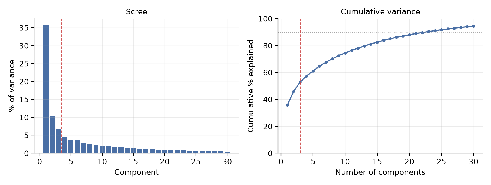
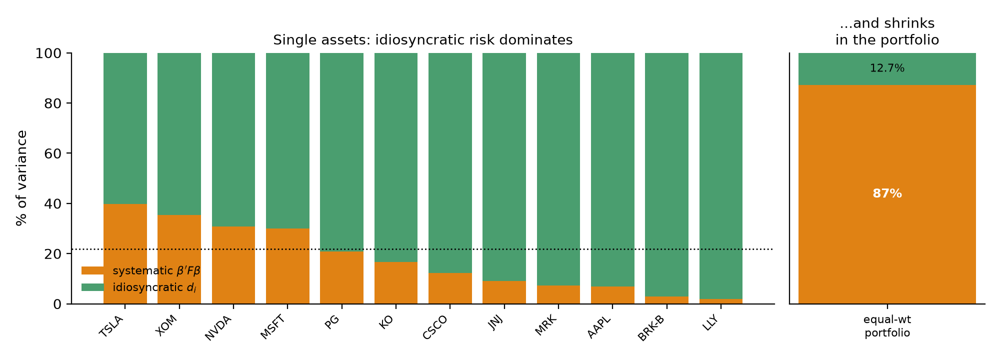

# Why We Need Factor Models

In Week 07 we covered CAPM, APT, and the Fama French family. In Week 08 we used those factors to attribute realized risk and return. In both cases the factors were given to us. This week we build the models.

The reason to do this is not elegance. It is that the sample covariance matrix stops working.

## The Parameter Counting Problem

A covariance matrix for $n$ assets has

$$
\frac{n(n+1)}{2}
$$

free parameters. For $n = 100$ that is 5,050 numbers. The data available to estimate them is $T \times n$.

Our data is the 100 largest stocks in SPY, with $T = 60$ daily returns from 8 July to 30 September 2026. We are estimating 5,050 parameters from 6,000 data points.

The files are in `Week09/data`, and `get_data.py` there rebuilds them. Prices come from Yahoo Finance and the Fama French factors from Ken French's data library. The constituents and their float adjusted market caps come from State Street's SPY holdings file. The window ends where the Fama French file ends, so every model is fit on the same 60 days.

## What Actually Breaks

Compute the sample covariance of the 100 stocks and look at the eigenvalues. The code for this section and the next is in `week09_01_singular_covariance.jl`.

| $n$ | $T$ | Parameters | Rank of $\widehat{\Sigma}$ | $\lambda_{\min}$ | Non-zero columns in $L$ |
|--:|--:|--:|--:|--:|--:|
| 100 | 60 | 5,050 | 59 | $\sim -10^{-18}$ | 59 of 100 |

: Sample covariance of 100 stocks from 60 daily observations {#tbl-fail}

The rank is $\min(T-1, n) = 59$. This is not an estimation error, it is a certainty. A sum of $T$ rank-one outer products cannot have rank greater than $T$, and centering the data costs one more. With $n > T$ the sample covariance is always singular.

Be careful about what has broken here. The PD Cholesky algorithm fails. The PSD version from Week 03, `chol_psd!` in the course library, does not -- it returns a valid root $L$ with 41 zero columns and reproduces $\widehat{\Sigma} = LL'$ to $9.9 \times 10^{-16}$. Of those 41, 38 are exactly zero. The other 3 come from pivots that rounding pushed slightly positive instead of slightly negative, and they survive at around $10^{-8}$, six orders of magnitude below the real columns. They carry no variance in any sense that matters. The Week 03 PCA simulation works too. Drop the zero eigenvalues and simulate the system from 59 random draws instead of 100.

So we can factor the matrix and we can simulate from it. That is the problem.

## What the Factorization Cannot Tell Us {#sec-nullspace}

$L$ has rank 59. Every simulated return vector $r = Lz$ lies in a 59 dimensional subspace of $\mathbb{R}^{100}$, and that subspace is the span of the 60 demeaned historical observations.

No matter how many scenarios we draw, each one is a linear combination of days we have already seen. There is no information in the estimate about the other 41 directions.

The matrix is not silent about those directions. It says they have exactly zero variance.

To see what that costs, estimate the covariance on the first 30 days only. The null space is then 71 dimensional. Pick any portfolio in that null space with weights summing to 1. The one below has a 5.4% maximum weight and 1.5x gross exposure, which is an ordinary looking portfolio. `week09_01_singular_covariance.jl` builds it and produces every row of @tbl-nullspace.

| | Value |
|:--|--:|
| Forecast volatility (in-sample) | 0% to numerical precision |
| Realized volatility, same 30 days | $\sim10^{-14}$% |
| Realized volatility, next 30 days | 6.82% |
| FF3 factor model forecast, same portfolio | 7.38% |

: A portfolio the sample covariance calls riskless {#tbl-nullspace}

The estimate says the portfolio is riskless and is internally consistent about it. Out of sample it runs at 6.8% annualized. The factor model, which never assigns zero risk to anything, would have told you 7.38%.

Run a minimum variance optimization on all 60 days using a pseudo-inverse and the answer depends on a numerical cutoff, not on the data. The pseudo-inverse needs a tolerance below which an eigenvalue counts as zero. With Julia's default, it drops the 41 zero eigenvalues and returns weights running from 6.2% long to 5.1% short at 2.23x gross. Tighten the tolerance so that it keeps some of the $10^{-18}$ rounding noise and the largest weight jumps to 49% at 7.35x gross. Neither is the true minimizer. Under the sample covariance the minimum variance is exactly zero, achieved by any null space portfolio like the one above. The optimizer is not finding a low risk portfolio. It is finding whatever the estimate, or the cutoff you picked, says is riskless.

## Two Ways Out

The first is to repair the matrix numerically. Week 03 gave us the tools -- Rebonato and Jackel, Higham, the PSD Cholesky, PCA.

None of them adds information. They are the right tools for a matrix that is nearly good and has been corrupted by floating point error or missing data. That is a numerical problem with a numerical fix.

Our problem is not numerical. Raising 41 zero eigenvalues to some small positive number gives you a matrix you can invert, but the directions it is built on are arbitrary and the risk it reports along them is whatever you picked when you patched it. You have converted "I know nothing here" into a specific number.

The second way is to change the model. If returns are driven by a small number of common factors we can write

$$
\Sigma = BFB' + D
$$

and estimate 406 parameters instead of 5,050. This is full rank and invertible for any $T$. The rank comes from the structure, not from a patch. Every asset gets its own strictly positive specific variance, so no portfolio is ever called riskless.

The trade is explicit. We buy conditioning, tractability, and interpretable exposures with a structural assumption. If the assumption is wrong we get a well behaved matrix that is confidently incorrect. @sec-wrong covers how to detect that.

# The General Linear Factor Model

For asset $i$ at time $t$:

$$
r_{i,t} = \alpha_i + \sum_{k=1}^{m} \beta_{i,k} f_{k,t} + \varepsilon_{i,t}
$$

For the cross-section at a single date:

$$
r_t = \alpha + B f_t + \varepsilon_t
$$

$r_t$ is $n\times 1$, $B$ is $n \times m$, $f_t$ is $m \times 1$, $\varepsilon_t$ is $n \times 1$. Stacking all $T$ dates:

$$
R = \mathbf{1}\alpha' + F B' + E
$$

with $F$ the $T\times m$ matrix of factor returns and $E$ the $T \times n$ matrix of residuals.

## Vocabulary

Three different things get called "the factor" in conversation. Keep them straight.

| Term | Symbol | Dim. | What it is |
|:--|:--|:--|:--|
| Exposure / loading / beta | $B$ | $n\times m$ | how much of factor $k$ asset $i$ carries |
| Factor return | $f_t$ | $m\times 1$ | what the factor did in period $t$ |
| Factor premium | $E[f]$ | $m\times 1$ | long run expected reward for the exposure |

: Three distinct objects {#tbl-vocab}

"Apple has a high momentum beta" is a statement about $B$. "Momentum was up 40bp yesterday" is about $f_t$. "Momentum earns 3% a year" is about $E[f]$. Only the last is an asset pricing claim. The first two are risk statements.

## The Assumptions

The model is the equation plus three assumptions. We violate all three later.

1. $E[\varepsilon_{i,t}] = 0$. The residual has no drift. Anything systematic left in the residual becomes $\alpha$, and $\alpha$ is either skill or a missing factor.

2. $\operatorname{cov}(f_{k,t}, \varepsilon_{i,t}) = 0$. In a time series model fit by OLS this holds in sample by construction. It is a property of the residual, not a testable claim. Out of sample it is a real assumption.

3. $\operatorname{cov}(\varepsilon_{i,t}, \varepsilon_{j,t}) = 0$ for $i \neq j$. The residual covariance $D$ is diagonal. This is the load bearing assumption. It is what collapses the parameter count and it is the one most often false. @sec-residcorr shows how to test it.

Write $F = \operatorname{cov}(f)$ and $D = \operatorname{diag}(d_1,\dots,d_n)$. Using assumptions 2 and 3:

$$
\Sigma = \operatorname{cov}(r) = B\,\operatorname{cov}(f)\,B' + \operatorname{cov}(\varepsilon) = BFB' + D
$$

Everything else in these notes follows from that line.

# Three Ways to Build a Factor Model

$R = FB' + E$ has two unknowns on the right. Which one you treat as observed determines the type of model and the direction of the regression.

{#fig-taxonomy width=100%}

| | Observed | Estimated | Regression | Examples |
|:--|:--|:--|:--|:--|
| Time-series | $f$ | $B$ | one per asset, over time | Fama French, Carhart, macro |
| Cross-sectional | $B$ | $f$ | one per date, across assets | BARRA, Axioma, Fama MacBeth |
| Statistical | neither | both | eigendecomposition | PCA, factor analysis |

: The three model types {#tbl-taxonomy}

In a time series model the factor returns are data and the betas are output. In a cross-sectional model the betas are data and the factor returns are output. In a statistical model nothing is data except returns.

There is no correct choice. They answer different questions.

- Time-series, when the factors are economically meaningful and observable. Market, rates, oil, the published FF portfolios. Best for attribution against a standard.
- Cross-sectional, when you have good firm characteristics and a large changing universe. This is what the commercial risk vendors sell.
- Statistical, when you want the risk structure with no priors, or as a diagnostic on the other two.

# Estimation

## Time-Series Models

The factor returns are given, so this is OLS run once per asset. Every asset shares the same right hand side, so do all $n$ at once. Let $X = [\mathbf{1} \;\; F]$ be $T \times (m+1)$.

$$
\widehat{\Theta} = (X'X)^{-1}X'R
\qquad
\widehat{\alpha} = \widehat{\Theta}_{1,\cdot}\,,\quad
\widehat{B}' = \widehat{\Theta}_{2:m+1,\cdot}
$$

One inverse of size $(m+1)\times(m+1)$ serves all $n$ assets. Residuals are $E = R - X\widehat{\Theta}$ and

$$
\hat{d}_i = \frac{1}{T-m-1}\sum_{t=1}^{T}E_{t,i}^2
$$

The $T - m - 1$ denominator matters. With $T = 60$ and $m = 3$ we divide by 56, not 60. Ignoring that biases every specific variance down by 7%, which biases the whole risk model down.

### Fitting FF3 to our data

Fit the three Fama French factors to the 100 stocks over the 60 days. The code is in `week09_02_ff3_time_series.jl`. It also reports the beta standard errors used below and the rank, conditioning and parameter count of the resulting $\Sigma$ from @sec-factorcov.

| | TSLA | MSFT | NVDA | CSCO | AAPL | BRK-B | JNJ | XOM |
|:--|--:|--:|--:|--:|--:|--:|--:|--:|
| $\beta_{\text{Mkt}}$ | 2.560 | 1.613 | 1.549 | 0.862 | 0.473 | 0.079 | 0.032 | -0.695 |
| $\beta_{\text{SMB}}$ | -0.315 | -0.907 | -0.539 | -0.805 | 0.476 | 0.112 | 0.097 | -0.841 |
| $\beta_{\text{HML}}$ | -0.410 | -0.609 | -0.712 | -0.219 | 0.777 | 0.278 | 0.623 | 0.624 |
| $R^2$ | 0.40 | 0.30 | 0.31 | 0.12 | 0.07 | 0.03 | 0.09 | 0.35 |
| Ann. $\sigma$ | 50.4% | 41.3% | 40.3% | 34.6% | 28.1% | 14.7% | 20.7% | 26.0% |

: FF3 betas, selected stocks, 60 daily observations {#tbl-ff3betas}

The HML signs are sensible. TSLA, MSFT, and NVDA load negatively, which is what high multiple growth names should look like. XOM and JNJ load positively.

The market betas need more care. XOM has a market beta of -0.70. Over these 60 days the market was driven by technology and energy went its own way. AAPL, BRK-B, and JNJ have $R^2$ below 0.10, so three factors say almost nothing about them in this window. Sixty days of data describe sixty days, not the company.

Across all 100 stocks the mean $R^2$ is 0.205, ranging from 0.003 (RTX) to 0.548 (COF). Three factors explain about 20% of a typical stock's daily variance. We come back to that number.

### Full sample vs rolling betas

Two choices, both defensible.

- Full sample. Equal weight on every observation. Lowest estimation error, assumes beta is constant over the window.
- Rolling or exponentially weighted. Tracks changing exposure at the cost of noisier estimates.

The standard error of an OLS beta is roughly

$$
\operatorname{se}(\hat\beta_k) \approx \frac{\sigma_\varepsilon}{\sigma_{f_k}\sqrt{T}}
$$

Halving the window multiplies the standard error by $\sqrt{2}$. On our data the median market beta standard error is already 0.36. A beta of 1.15 and a beta of 0.85 are less than one standard error apart. A rolling 20 day beta on daily data is mostly noise.

My opinion: on daily data use at least a year. If you need faster adaptation, use exponential weighting rather than a short window. You keep effective sample size while still down-weighting the past.

## Cross-Sectional (Fundamental) Models

Invert the problem. Instead of observing factor returns and estimating betas, we observe the betas and estimate the factor returns.

Observed betas come from firm characteristics.

- Industry or sector membership, as 0/1 dummies
- Size, $\log(\text{market cap})$
- Value, book to price or earnings to price
- Leverage, profitability, trading activity, historical volatility

These are called descriptors. They are observable today for every stock with no regression required. A newly listed stock has a book to price ratio on day one. It has no beta until you have a return history.

### Standardizing descriptors

Raw descriptors are not usable directly. $\log(\text{cap})$ is around 25 and book to price is around 0.3, so the factor returns would be on wildly different scales. Standardize cross-sectionally at each date.

$$
z_{i,k} = \frac{x_{i,k} - \bar{x}_k}{s_k}
$$

Then winsorize at roughly $\pm 3$. One stock with a book to price of 40 because its book value is an accounting artifact will otherwise run the entire regression for that day.

After standardizing, a factor return is the return to a portfolio with one unit of standardized exposure.

### The regression

At each date $t$, regress that day's returns on the known exposure matrix.

$$
r_t = B f_t + \varepsilon_t
\qquad\Longrightarrow\qquad
\hat{f}_t = (B'WB)^{-1}B'W r_t
$$

One regression per date, $n$ observations and $m$ regressors. That is the opposite orientation from the time series case. Repeating over $T$ dates gives a time series of estimated factor returns.

$W$ is a weighting matrix. Two standard choices:

- $W = D^{-1}$, inverse specific variance. This is GLS and is efficient if $D$ is known.
- $W = \operatorname{diag}(\sqrt{\text{mktcap}})$. A common vendor choice. It damps small illiquid names without letting the mega caps run the regression.

The first requires $D$, which requires residuals, which requires the regression. In practice you iterate. Run OLS, get residuals, estimate $D$, re-run as GLS. @sec-wchoice compares these and the other common choices.

### Factor returns are portfolio returns

Look at the estimator again.

$$
\hat{f}_t = \underbrace{(B'WB)^{-1}B'W}_{\textstyle \Omega,\ \ m\times n} \, r_t
$$

$\Omega$ does not depend on $r_t$. Each row of $\Omega$ is a vector of $n$ weights, and the factor return is the return on that portfolio.

$$
\hat{f}_{k,t} = \sum_{i=1}^{n} \Omega_{k,i}\, r_{i,t}
$$

These are factor mimicking portfolios. Three consequences:

1. The estimated factor returns are achievable. You can hold the portfolio.
2. $\Omega B = I$ by construction, so the mimicking portfolio for factor $k$ has unit exposure to $k$ and zero exposure to every other factor. Cross-sectional factor returns are purified in a way that the Fama French portfolios are not. HML has a well known negative market beta.
3. It gives you a hedge. Short the mimicking portfolio to neutralize an unwanted exposure.

### Identification

Suppose $B$ has a market column of ones plus a full set of industry dummies. The dummies sum to the market column, $B$ is rank deficient, and $(B'WB)^{-1}$ does not exist.

The standard fix is a constraint forcing the industry factor returns to sum to zero.

$$
\sum_{k \in \text{industries}} c_k f_{k,t} = 0
$$

The $c_k$ are weights we choose. The constraint says the $c$ weighted average of the industry factor returns is zero every day. Each industry factor is then that industry's return relative to an "average industry," and $c$ defines what average means. The market factor carries everything the industries have in common.

Three choices of $c_k$ are common.

| Name | $c_k$ | Each industry counts | Industries measured against |
|:--|:--|:--|:--|
| Equal | 1 | once, whatever its size | the average industry |
| Count | $n_k$, the number of stocks in industry $k$ | by how many stocks it holds | the average stock |
| Cap | industry $k$'s share of total market cap | by its market value | the average dollar |

: Common choices of constraint weights {#tbl-cchoice tbl-colwidths="[10,32,26,32]"}

The difference is not small. Our universe has 28 Tech stocks and 7 in Staples. Under the equal constraint those two industries count the same. Under the count constraint Tech counts four times as much. Under the cap constraint Tech is 43.8% of the total and Staples 5.1%, so Tech counts more than eight times as much.

Write the constraint as a row vector $C = [\,0 \;\; c_1 \;\cdots\; c_K\,]$, with a zero in the market's position, so it reads $C f_t = 0$. Solve the regression subject to it through the KKT system.

$$
\begin{bmatrix} B'WB & C' \\ C & 0 \end{bmatrix}
\begin{bmatrix} f_t \\ \lambda \end{bmatrix}
=
\begin{bmatrix} B'W r_t \\ 0 \end{bmatrix}
$$

Our model uses the equal constraint. From here on the three are the equal, count, and cap constraints.

The constraint is not cosmetic. It defines what "the market factor" means. With the cap constraint and cap weights in $W$, the market factor return is the cap weighted market return and the industries are pure relative effects. Change the constraint and you change the interpretation of every factor. @sec-mktfactor works through the other choices.

### Choosing the weighting matrix {#sec-wchoice}

$W$ sets how much each stock counts in the daily regression. It also sets what the factors are. Every factor return is a portfolio return through $\Omega = (B'WB)^{-1}B'W$, so a different $W$ is a different set of portfolios.

@tbl-wchoice summarizes the four common choices.

**Equal weights, $W = I$** -- ordinary least squares.

- Needs nothing beyond returns, and the estimates are unbiased.
- Inefficient. A stock at 104% specific volatility counts as much as one at 11%.
- In a broad universe most names are small. Small caps run the regression and the factors track equal weighted portfolios.

**Inverse specific variance, $W = D^{-1}$** -- GLS, and what our model uses.

- The minimum variance estimator of $f_t$ when $D$ is right. Noisy stocks get little say.
- Needs a first OLS pass to estimate $D$, and inherits that pass's estimation error. One bad $d_i$ moves the weights.
- The factors tilt toward low specific risk names. On our data the market factor's largest weights are PEP and HD at 3.3% and DIS at 2.7%, none of which is above 0.7% of the cap weighted index. AAPL is 10.7% of that index and gets 0.4%. SNDK gets 0.08%. That is a low volatility portfolio, not an index.

**Market cap, $W = \operatorname{diag}(\text{mktcap})$.**

- In a market plus industry model with the cap constraint from @tbl-cchoice, the market factor is exactly the cap weighted index. Factor returns reconcile to the benchmark the portfolio manager is measured against.
- The mega caps run the regression. An industry factor becomes close to the return of its two or three largest names, and their stock specific news lands in the factor.
- Inefficient. A stock ten times larger does not have one tenth the specific variance.

**Square root of cap, $W = \operatorname{diag}(\sqrt{\text{mktcap}})$** -- the common vendor choice.

- Sits between equal and cap weights. It damps small illiquid names without letting the mega caps run the regression.
- A stable stand-in for $D^{-1}$ that needs no first pass, because specific variance falls with size.
- With the cap constraint, the market factor is close to the cap weighted index but not equal to it. The gap is the size effect inside each industry.

| $W$ | Market factor tracks | Efficiency | Needs | Main weakness |
|:--|:--|:--|:--|:--|
| $I$ | equal weighted stocks | low | returns only | small caps dominate |
| $D^{-1}$ | a low specific risk tilt | highest, if $D$ is right | a first pass for $D$ | not an index, inherits error in $D$ |
| mktcap | the cap weighted index | low | market caps | mega caps dominate the factors |
| $\sqrt{\text{mktcap}}$ | close to the cap weighted index | middle | market caps | only approximately the index |

: Choices of regression weights. The second column assumes the count constraint with $I$ and the cap constraint with the cap based weights. {#tbl-wchoice tbl-colwidths="[14,24,18,18,26]"}

Whatever the base choice, cap the largest weights. No single name should carry an industry.

For a risk model used against a cap weighted benchmark, use $\sqrt{\text{mktcap}}$ with the cap constraint. Exposures and factor returns then line up with the benchmark, and the regression is not hostage to five stocks. For the cleanest estimate of the factor returns themselves, use GLS. Either way, state the choice next to the factor returns. Two models with different $W$ do not report comparable factor returns, even on the same data.

The model in @sec-xsdata uses GLS with the equal constraint, the two step method above. @sec-mktfactor runs the cap based choices on the same data.

### The market factor {#sec-mktfactor}

Every stock has a market loading of 1. The market factor is the intercept of each day's regression, and its return is the return on whatever portfolio $W$ and $C$ make it.

With a market column, industry dummies, and a diagonal $W$, that portfolio has a closed form. The fit for stock $i$ in industry $g$ is $f_{\text{mkt}} + f_g$. The best that sum can do is the $W$ weighted average return of the industry:

$$
\hat{f}_{\text{mkt},t} + \hat{f}_{g,t} = m_{g,t} = \frac{\sum_{i \in g} W_{ii}\, r_{i,t}}{\sum_{i \in g} W_{ii}}
$$

The constraint $\sum_k c_k f_k = 0$ then pins down the market factor as the $c$ weighted average of the industry averages.

$$
\hat{f}_{\text{mkt},t} = \sum_k \tilde{c}_k\, m_{k,t},
\qquad \tilde{c}_k = \frac{c_k}{\sum_j c_j}
$$

So the market factor holds stock $i$ at

$$
\omega_i = \tilde{c}_{g(i)}\,\frac{W_{ii}}{\sum_{j \in g(i)} W_{jj}}
$$

The constraint sets the weight across industries. $W$ sets the weight within each one. Using the constraint names from @tbl-cchoice:

- $W$ = mktcap with the cap constraint. Then $\omega_i = \text{mktcap}_i / \sum_j \text{mktcap}_j$, exactly the cap weighted index.
- $W = I$ with the count constraint. Then $\omega_i = 1/n$, the equal weighted index.
- $W = \sqrt{\text{mktcap}}$ with the cap constraint. Cap weighted across industries, $\sqrt{\text{mktcap}}$ weighted within them.
- $W = D^{-1}$ with the equal constraint, our model. One eighth per industry whatever its size, with the quiet names favored inside each.

Add style factors and the closed form goes away. The market factor becomes the mimicking portfolio with unit market exposure and zero exposure to every style. Vendors standardize style exposures to a cap weighted mean of zero. The cap weighted index then has no style exposure, and the market factor stays close to it.

**What the choice does to $\hat{f}_{\text{mkt}}$** -- re-estimate our model under seven combinations of $W$ and constraint. Compare each market factor's return series to the cap weighted portfolio of our 100 stocks, and to SPY. The cap weighted 100 is the S&P 500 restricted to its 100 largest names. It is 74.6% of SPY by weight, has a 0.979 correlation with it, and runs 2.55% tracking error against it.

| $W$ | Constraint | Ann. vol | Corr with cap 100 | Beta to cap 100 | TE vs cap 100 | TE vs SPY |
|:--|:--|--:|--:|--:|--:|--:|
| $I$ | Equal | 8.7% | 0.737 | 0.527 | 8.20% | 7.27% |
| $I$ | Count | 10.2% | 0.878 | 0.737 | 5.82% | 4.49% |
| $D^{-1}$ | Equal | 8.4% | 0.631 | 0.437 | 9.44% | 8.50% |
| $D^{-1}$ | Count | 9.5% | 0.837 | 0.653 | 6.67% | 5.30% |
| $D^{-1}$ | Cap | 12.2% | 0.873 | 0.877 | 6.12% | 4.75% |
| $\sqrt{\text{mktcap}}$ | Cap | 13.0% | 0.960 | 1.028 | 3.64% | 3.26% |
| mktcap | Cap | 12.1% | 1.000 | 1.000 | 0.00% | 2.55% |

: The estimated market factor under different $W$ and constraint. Constraint names are from @tbl-cchoice. {#tbl-mktfactor tbl-colwidths="[13,14,10,15,15,16,17]"}

The last row is the closed form at work. $W$ = mktcap with the cap constraint reproduces the cap weighted 100 to $10^{-17}$, and $W = I$ with the count constraint reproduces the equal weighted 100 to the same precision.

Our market factor, $D^{-1}$ with the equal constraint, is the furthest from the index. It has a beta of 0.44 to the cap weighted 100 and runs 9.4% tracking error against it. In this window Tech is 44% of the index and drove most of its move. Our market factor gives Tech one eighth.

The constraint does most of the work. Holding $W = D^{-1}$ and moving from the equal to the cap constraint cuts the tracking error from 9.4% to 6.1%. What remains comes from $W$. Inside each industry $D^{-1}$ still favors the quiet names over the mega caps.

$\sqrt{\text{mktcap}}$ with the cap constraint gets within 3.6%. Inside Tech it holds AAPL at 5.1% against a cap weight of 10.7%, and NVDA and MSFT at 4.4% against 8.1% and 8.0%. Exactly the damping of the mega caps it was chosen for, and the price is that the market factor is not quite the index.

The constraint changes the name, not the risk. $B$ is rank deficient, so every constraint produces the same fitted values $B\hat{f}_t$, the same residuals, and the same $\Sigma$. The script confirms that to $10^{-18}$. What moves is the split between the market factor and the industries, and so $F$ and every factor attribution. $W$ is different. It changes the fit itself, and $\Sigma$ changes with it. Moving from $D^{-1}$ to $\sqrt{\text{mktcap}}$ changes entries of $\Sigma$ by up to $3.7 \times 10^{-4}$, against a largest entry of $4.8 \times 10^{-3}$.

**Beta to the cap weighted market** -- when the market factor is not the cap weighted index, a market loading of 1 is not a beta of 1 to the index. Get that beta from $\Sigma$. With cap weights $w_m$ and $x_m = B'w_m$, the market's factor exposures,

$$
\beta_i = \frac{(\Sigma w_m)_i}{w_m'\Sigma w_m}
= \frac{b_i' F x_m + w_{m,i}\, d_i}{x_m' F x_m + \sum_j w_{m,j}^2\, d_j}
$$

$b_i$ is row $i$ of $B$. A portfolio's beta to the index is $\beta_p = w'\beta$, and the index itself has $\beta = 1$.

Compare the beta to the market factor itself.

$$
\beta_i^{f} = \frac{(F b_i)_{\text{mkt}}}{F_{\text{mkt},\text{mkt}}}
$$

The two agree only when the market factor is the cap weighted index.

In a market plus industry model $b_i' F x_m = (F x_m)_{\text{mkt}} + (F x_m)_{g(i)}$. Every stock in an industry gets the same value, and the same $\beta_i^f$. Betas to the index inside an industry differ only through $w_{m,i} d_i$. That term matters for a name with a large weight or a large specific variance.

| Industry | Beta to market factor | Model beta to cap 100 | Historical beta to cap 100 |
|:--|--:|:--|:--|
| Tech | 0.58 | 1.39 to 2.43 | -0.14 to 3.68 |
| Discretionary | 1.65 | 0.38 to 0.91 | 0.03 to 2.56 |
| Industrials | 0.98 | 0.59 to 0.63 | -0.30 to 1.77 |
| Financials | 1.29 | 0.41 to 0.44 | -0.63 to 1.86 |
| Comm. Services | 1.42 | 0.14 to 0.45 | -0.01 to 1.43 |
| Health | 1.06 | -0.03 to 0.02 | -0.47 to 1.25 |
| Staples | 0.99 | -0.18 to -0.14 | -1.02 to 0.22 |
| Other | 0.02 | -0.19 to -0.17 | -0.91 to 1.46 |

: Betas from our model ($D^{-1}$, equal constraint), range within each industry. $w_m$ is the float adjusted cap weight. {#tbl-xsbeta tbl-colwidths="[18,22,30,30]"}

The two model betas disagree, and the disagreement is the point. Staples has a beta of 0.99 to our market factor and a beta of -0.16 to the cap weighted index. Tech is the reverse, at 0.58 to the market factor and 1.39 or more to the index. Our market factor is an equal blend of eight industries. The index is 44% Tech. A portfolio manager hedging against the index needs the second column, not the first.

Inside an industry the model betas barely move, with one exception. AAPL is 10.7% of the index, so its own specific variance is a large part of the index's variance, and the $w_{m,i} d_i$ term lifts its model beta to 2.43. Its historical beta is 0.21. AAPL spent this window moving against the rest of Tech, and our model cannot represent that. AAPL loads +1 on the Tech factor, the misfit lands in its residual, and its specific volatility comes out at 45%, above its total volatility of 28%. The own weight term is only as good as $d_i$. For a mega cap it is large enough to matter.

The historical betas inside each industry spread over a range of one and a half to four. Vendors close that gap with a Beta style factor. The descriptor is a historical beta, standardized like any other. A time series estimate comes back into the model, but as an observed exposure, not as the market loading.

The code for this section and the last is at the end of `week09_04_cross_sectional.jl`.

### Fama MacBeth inference

We have $T$ estimates $\hat{f}_1,\dots,\hat{f}_T$. Fama and MacBeth (1973) use the time series of the cross-sectional estimates rather than modeling the cross-sectional correlation.

$$
\bar{f}_k = \frac{1}{T}\sum_{t=1}^T \hat{f}_{k,t}
\qquad
t\text{-stat} = \frac{\bar{f}_k}{s(\hat{f}_k)/\sqrt{T}}
$$

Residuals within a single date are heavily correlated, since everything moves with the market. Standard errors from any one cross-sectional regression are badly understated. The estimates across dates are approximately independent, because daily returns are approximately serially uncorrelated. So the dispersion of the estimates over time gives valid inference and we never model the within-date correlation.

The limitation is that it assumes no serial correlation in $\hat{f}_t$. If there is any, use Newey West standard errors.

### A cross-sectional model on our data {#sec-xsdata}

Market factor plus 8 industry groups, weighted by inverse specific variance, sum to zero constrained. The code is in `week09_04_cross_sectional.jl`. It follows the two steps above. A first pass by OLS gives residuals, the residuals give a specific variance for each stock, and a second pass uses $W = D^{-1}$. The weighting matters here. Specific volatility from the OLS pass runs from 11.5% for PEP to 104.5% for SNDK, so GLS gives PEP 82 times the weight of SNDK. The market factor from the two passes has a 0.971 correlation.

| Factor | Mean return (bp/day) | Ann. vol | FM $t$-stat |
|:--|--:|--:|--:|
| Market | -1.8 | 8.4% | -0.26 |
| Tech | +14.4 | 27.2% | +0.65 |
| Health | +13.4 | 14.7% | +1.13 |
| Comm. Services | +10.4 | 16.6% | +0.77 |
| Other | +3.5 | 13.8% | +0.32 |
| Financials | -5.6 | 9.8% | -0.71 |
| Staples | -5.7 | 14.2% | -0.50 |
| Industrials | -7.9 | 16.0% | -0.61 |
| Discretionary | -22.5 | 12.0% | -2.31 |

: Cross-sectional factor returns, 60 days {#tbl-xsfactors}

One $t$-statistic clears 2.0, Discretionary at -2.31. That is not evidence of anything. Test nine factors at 5% and chance alone produces 0.45 false positives on average. Sixty days is far too short to say anything about factor premia. The volatilities are estimated much more precisely than the means. Use this model for risk. Do not use these means as expected returns.

## Statistical Models

Neither $B$ nor $f$ is observed. Extract both from the covariance matrix. This is Week 03 PCA applied to a new purpose.

$$
\widehat{\Sigma} = S\Lambda S'
$$

Keep the largest $m$ eigenvalues and set

$$
B = S_{[\cdot,1:m]}\,\Lambda_{[1:m]}^{1/2}, \qquad F = I_m
$$

The factors are the principal components scaled to unit variance, so $F$ is the identity and $BFB' = BB'$. The specific variances are what the components did not explain.

$$
d_i = \widehat{\Sigma}_{ii} - \sum_{k=1}^m B_{i,k}^2
$$

### Rotation indeterminacy

For any orthogonal $m\times m$ matrix $Q$,

$$
B f = (BQ)(Q'f)
\qquad\text{and}\qquad
(BQ)(BQ)' = BQQ'B' = BB'
$$

Loadings $BQ$ with factors $Q'f$ fit the data equally well and give an identical covariance matrix. Statistical factors are only identified up to rotation.

This is where students most often go wrong. PC1 is not the market factor. PC1 is the direction of maximum variance, which for equity returns is usually close to a market-like direction, but the model has no opinion about that.

The code for this whole section is in `week09_03_pca_statistical.jl`. Our window shows how wrong the assumption can be. Only 61% of the PC1 loadings share a sign, and the PC1 portfolio return has a correlation of 0.53 with SPY. Eigenvector signs are arbitrary, so the script prints these as negative numbers. PC1 is long semiconductors and storage (SNDK, MU, MRVL, LRCX, INTC) and short software, services, and defensives (ACN, CRM, MO, ADP, BKNG). That spread was the largest source of variance in these 60 days.

The PC1 loadings still have a correlation of 0.71 with the FF3 market betas. In this window 8 of the 12 highest market betas belong to semiconductor names. PC2 is closer to a market factor, with 83% of loadings sharing a sign and a 0.69 correlation with SPY. Neither is the market. PCA ranks components by variance, and it never promised that the largest one has a name.

The practical consequence: statistical models are good for risk, which depends only on $BB' + D$ and is rotation invariant. They are awkward for attribution, which requires naming the factors.

### Choosing $m$

- Scree plot. Eigenvalues in descending order, look for the elbow where they flatten into the noise floor.
- Cumulative variance. Keep enough components to hit a target.
- Information criteria. Bai and Ng (2002) penalize $m$ correctly when both $n$ and $T$ are large.

$$
IC_{p1}(m) = \ln V(m) + m\left(\frac{n+T}{nT}\right)\ln\left(\frac{nT}{n+T}\right)
$$

$V(m)$ is the mean squared residual. Minimize over $m$. This is preferable to eyeballing a scree plot, though the answer is often the same.

{#fig-scree width=95%}

| Components | 1 | 2 | 3 | 5 | 10 | 20 | 59 |
|:--|--:|--:|--:|--:|--:|--:|--:|
| Cumulative variance | 35.7% | 46.1% | 53.0% | 61.1% | 74.5% | 88.1% | 100.0% |

: Variance explained by principal components {#tbl-scree}

The first component explains 35.7%, the second adds 10.4%, and the third 6.9%. After that the drop-off is gradual, which is typical for equity returns. The elbow argument supports $m = 3$. A 90% of variance rule would demand more than 20 factors, which is overfitting 60 observations.

The eigenvalues also run out at 59. Everything past that is exactly zero. That is the rank problem again.

### Asymptotic PCA when $n > T$

Eigendecomposing a $100\times100$ matrix built from 60 observations is wasteful. At most 59 eigenvalues are non-zero. Connor and Korajczyk (1986) work with the $T \times T$ matrix instead.

$$
\Omega = \frac{1}{n}\tilde{R}\tilde{R}' \quad (T\times T)
$$

$\tilde{R}$ is the demeaned return matrix. The non-zero eigenvalues of $\Omega$ match those of $\frac{1}{n}\tilde{R}'\tilde{R}$, and the eigenvectors of $\Omega$ give the factor realizations directly. Recover the loadings by regressing returns on those factors.

Cost is $O(T^3)$ instead of $O(n^3)$, and it is better conditioned. For $n=100, T=60$ the saving is modest. For 3,000 stocks on 250 days it is a factor of 1,700.

### PCA on correlation vs covariance

These give different answers. PCA on the covariance matrix is dominated by the highest variance assets. With TSLA at 50% annualized volatility and JNJ at 21%, TSLA gets roughly 6 times the influence of JNJ in the first component. PCA on the correlation matrix treats every asset equally.

My opinion: for a risk model use covariance, because you care about dollars of risk and the high volatility names genuinely matter more. For exploratory structure finding use correlation, so a few volatile names do not dictate the answer.

# The Factor Covariance Matrix {#sec-factorcov}

Everything follows from

$$
\Sigma = BFB' + D
$$

{#fig-sigma width=100%}

## Parameter Count

$$
\underbrace{nm}_{B}\;+\;\underbrace{\frac{m(m+1)}{2}}_{F}\;+\;\underbrace{n}_{D}
\;=\; 300 + 6 + 100 \;=\; 406
\qquad\text{versus}\qquad
\frac{n(n+1)}{2} = 5{,}050
$$

A 12 fold reduction. More important, the count is linear in $n$ rather than quadratic. Doubling the universe doubles the parameters instead of quadrupling them.

## Positive Semi-Definiteness

Claim: if $F$ is PSD and $d_i \geq 0$ for all $i$, then $\Sigma = BFB' + D$ is PSD. If $F$ is PD and $d_i > 0$, then $\Sigma$ is PD.

Proof: for any $x \in \mathbb{R}^n$, let $y = B'x$.

$$
x'\Sigma x = x'BFB'x + x'Dx = y'Fy + \sum_{i=1}^n d_i x_i^2
$$

The first term is $\geq 0$ because $F$ is PSD, the second because every $d_i \geq 0$. If $d_i > 0$ for all $i$ then the second term is strictly positive for $x \neq 0$. $\blacksquare$

Compare that to Week 03. There we estimated a covariance matrix, found it was not PSD, and repaired it. Here the question never comes up. As long as we do not produce a negative specific variance, PSD is automatic.

The factor structure is a parameterization of the PSD cone. Every matrix of the form $BFB'+D$ with $F \succeq 0, D \succeq 0$ is PSD, and no adjustment to $B$ can leave the cone.

The one thing to check is $d_i \geq 0$. In a statistical model $d_i = \Sigma_{ii} - \sum_k B_{ik}^2$ can go negative if the components over-explain an asset. That is a Heywood case. Floor it at a small positive number. On our data the minimum $d_i$ from the 3 component model is $6.12\times10^{-5}$, so no flooring was needed.

## Rank and Invertibility

$\operatorname{rank}(BFB') = \min(n,m) = m$ when $B$ has full column rank. So $BFB'$ is massively singular, rank 3 out of 100.

Adding $D$ with a strictly positive diagonal fixes it. From the proof above $x'\Sigma x \geq \min_i d_i \cdot \|x\|^2 > 0$, so $\lambda_{\min}(\Sigma) \geq \min_i d_i$.

The idiosyncratic term is what makes the matrix invertible. Students think of $D$ as leftover junk. It is doing the structural work.

It also rules out the null space problem from @sec-nullspace. There a portfolio existed with $w'\widehat{\Sigma}w = 0$ exactly. Under a factor model the best a portfolio can do is neutralize all $m$ factor exposures, which leaves $w'\Sigma w = \sum_i w_i^2 d_i > 0$. The model never calls a portfolio riskless because it never claims certainty about a single stock.

| | Sample | FF3 factor model | PCA-3 model |
|:--|--:|--:|--:|
| Rank | 59 | 100 | 100 |
| $\lambda_{\min}$ | $\sim -10^{-18}$ | $6.92\times10^{-5}$ | $6.14\times10^{-5}$ |
| Condition number | undefined | 178 | 373 |
| Non-zero columns in $L$ | 59 of 100 | 100 | 100 |
| Parameters | 5,050 | 406 | 406 |

: The three covariance estimates compared {#tbl-compare}

`week09_03_pca_statistical.jl` ends by printing this comparison.

Condition numbers of 178 and 373 describe well behaved matrices. For the sample estimate the condition number is not a large number, it is undefined. $\lambda_{\min}$ is zero, and whatever your software prints is a report on rounding. Values above $10^{13}$ are typical and the figure changes with the LAPACK path.

## Fast Inversion, the Woodbury Identity

Inverting a $100\times100$ matrix is cheap. For a real universe of 3,000 to 8,000 names an $O(n^3)$ inverse inside an optimizer loop is not.

The Sherman Morrison Woodbury identity:

$$
(D + BFB')^{-1} = D^{-1} - D^{-1}B\left(F^{-1} + B'D^{-1}B\right)^{-1}B'D^{-1}
$$

Look at the right hand side. $D^{-1}$ is a diagonal inverse, $n$ divisions. $F^{-1}$ is $m\times m$ and trivial. $B'D^{-1}B$ is $m\times m$, formed in $O(nm^2)$. The only real inverse is of an $m\times m$ matrix.

Total cost is $O(nm^2)$ instead of $O(n^3)$. With $m = 3$ that is effectively linear in $n$.

| $n$ | 100 | 500 | 1,000 | 2,000 | 5,000 |
|:--|--:|--:|--:|--:|--:|
| Direct (ms) | 0.037 | 6.11 | 11.9 | 43.2 | 410 |
| Woodbury (ms) | 0.002 | 0.006 | 0.011 | 0.036 | 0.080 |
| Speedup | 22x | 1,019x | 1,111x | 1,191x | 5,130x |

: Cost of solving with and without the factor structure {#tbl-woodbury}

Maximum relative difference between the two answers is $7.4\times10^{-16}$. It is the same answer.

The code is in `week09_05_woodbury.jl`. Timings depend on the machine and the BLAS library, so your numbers will differ from the table, but the shape should not.

Going from $n = 100$ to $n = 5{,}000$ multiplies the direct cost by about 11,000. Theory says $50^3 = 125{,}000$, and the gap is fixed overhead, which dominates at $n = 100$. The Woodbury cost grows only about in proportion to $n$ and stays well under a tenth of a millisecond. It is not just faster, it barely grows. Commercial optimizers store the covariance in factor form for this reason, and they never form $\Sigma$ explicitly at all. An $8{,}000\times8{,}000$ dense matrix is 512MB. The factor form is about 0.3MB.

## Factor Structure vs Shrinkage

Factor models are not the only route to a well conditioned covariance. Ledoit and Wolf take a convex combination of the sample covariance and a structured target.

$$
\Sigma_{\text{shrunk}} = \delta\, T_{\text{target}} + (1-\delta)\,\widehat{\Sigma}_{\text{sample}}
$$

$\delta$ is chosen to minimize expected squared error. Common targets are a scaled identity or the constant correlation matrix.

Both approaches fix the conditioning. They differ in what they assume and what they return.

| | Factor model | Shrinkage |
|:--|:--|:--|
| Assumption | returns driven by $m$ common factors | none structural, target is a bias/variance device |
| Well conditioned | yes, by construction | yes, for $\delta > 0$ |
| Gives exposures | yes | no |
| Supports attribution | yes | no |
| Fast inverse | yes, Woodbury | no, dense |
| Fails when | the factors are wrong | never badly, but never great |
| Parameters | $O(nm)$ | $O(n^2)$, regularized |

: Two routes to a usable covariance matrix {#tbl-shrink}

The two are closer than they look. Ledoit and Wolf's 2003 paper used the single index model as the shrinkage target. The target was a one factor model. A factor model is then the $\delta = 1$ corner, full commitment to the structure with no sample covariance at all.

That suggests the hybrid, which is what practitioners do. Shrink the sample matrix toward the factor model rather than choosing between them.

My opinion: if all you need is a number for portfolio volatility, shrinkage is simpler and hard to beat. If you need to answer why the risk is that number, or what happens if the market rallies 2%, you need a factor model. Shrinkage answers neither question.

# Systematic and Idiosyncratic Risk

The factor structure splits every variance into two pieces.

$$
\sigma_i^2 = \underbrace{\beta_i' F \beta_i}_{\text{systematic}} + \underbrace{d_i}_{\text{idiosyncratic}}
$$

The systematic share is the regression $R^2$.

$$
R_i^2 = \frac{\beta_i' F \beta_i}{\beta_i' F \beta_i + d_i}
$$

For a portfolio $w$, define the portfolio exposure vector

$$
x = B'w \qquad (m\times 1)
$$

Then

$$
\sigma_p^2 = w'\Sigma w = \underbrace{x'Fx}_{\text{systematic}} + \underbrace{\sum_{i=1}^n w_i^2 d_i}_{\text{idiosyncratic}}
$$

## Diversification

The idiosyncratic term is $\sum_i w_i^2 d_i$. For an equally weighted portfolio $w_i = 1/n$, so

$$
\sum_{i=1}^n \frac{1}{n^2}d_i = \frac{1}{n}\bar{d} \;\longrightarrow\; 0 \quad\text{as } n \to \infty
$$

Idiosyncratic variance falls at rate $1/n$. The systematic term $x'Fx$ does not fall at all. That is the precise statement of "diversification eliminates specific risk but not market risk."

The numbers in this section and in @sec-exante come from `week09_06_ex_ante_risk.jl`.

{#fig-vardecomp width=100%}

| | Typical single stock | AAPL alone | Equal-weighted 100-stock portfolio |
|:--|--:|--:|--:|
| Systematic share of variance | 20.5% | 6.9% | 87.3% |
| Idiosyncratic share | 79.5% | 93.1% | 12.7% |

: Idiosyncratic risk at the asset level and the portfolio level {#tbl-vardecomp}

For a single stock most of the variance is idiosyncratic, and the factors explain about a fifth of it. For a portfolio of the same 100 stocks the idiosyncratic share falls to 13%. It is not gone, because each stock's specific variance is so large relative to its factor variance in this window, but it has fallen from four fifths of the variance to an eighth.

This is why a 3 factor model can be a poor description of one stock and a good description of a diversified portfolio. It is also why the diagonal $D$ assumption is more forgivable than it looks. Errors in $D$ get multiplied by $w_i^2$.

In volatility terms:

$$
10.10\% = \sqrt{(9.43\%)^2 + (3.60\%)^2}
$$

Risk adds in quadrature. The idiosyncratic piece is more than a third the size of the systematic piece, and it adds only 0.67 points to the total.

# Ex-Ante Risk {#sec-exante}

## Working in Exposure Space

$x = B'w$ reduces a 100 dimensional portfolio to a 3 dimensional risk description.

| | Mkt-RF | SMB | HML |
|:--|--:|--:|--:|
| Exposure $x = B'w$ | 0.852 | +0.089 | +0.099 |
| Share of portfolio variance | 90.5% | 1.0% | -4.3% |

: Equal-weight portfolio exposures {#tbl-exposures}

A portfolio manager can hold three numbers in their head. They cannot hold 100 weights and a $100\times100$ correlation matrix.

The negative shares are not an error. Marginal contribution to variance is

$$
\frac{\partial \sigma_p^2}{\partial x_k} = 2(Fx)_k
$$

so the share for factor $k$ is $x_k (Fx)_k / \sigma_p^2$. With a market exposure near 1, the sign of each share is driven by the factor's correlation with the market. HML moved against the market over this window, $-0.51$, and the portfolio is long HML, so the tilt offsets some market risk. SMB barely moved with the market, $+0.10$, and its share is about 1%. The idiosyncratic term takes the remaining 12.7%. Contributions can be negative. That is the point of hedging, and it is the Week 08 decomposition applied in factor space.

## Factor Risk Attribution

Week 08 carries over directly. Same Euler decomposition:

$$
\sigma_p = \sum_{k=1}^{m} x_k \frac{\partial \sigma_p}{\partial x_k}
= \sum_{k=1}^m \frac{x_k (Fx)_k}{\sigma_p}
$$

plus the idiosyncratic term $\sum_i w_i^2 d_i / \sigma_p$. The sum is exact. The difference from Week 08 is that we no longer need a regression. We have $B$ and $F$ directly, so this is ex-ante rather than ex-post.

## Simulation and Factor VaR

Week 05 simulated $n$ dimensional joint distributions with copulas. That gets expensive and statistically shaky as $n$ grows. A Gaussian copula on 100 series needs a $100\times100$ correlation matrix, and we know how that ends with 60 observations.

The factor model restructures the simulation.

{#fig-simflow width=100%}

For each of $S$ scenarios:

1. Draw a factor return vector $f^{(s)}$ from the joint factor distribution. $m$ dimensions, so the copula and marginals are fit on $m$ series.
2. Draw $n$ independent idiosyncratic returns $\varepsilon_i^{(s)}$. Independent because $D$ is diagonal. No copula needed.
3. Form $r^{(s)} = \alpha + Bf^{(s)} + \varepsilon^{(s)}$.
4. Compute $P^{(s)} = w'r^{(s)}$.
5. Take the empirical quantile for VaR and the tail mean for ES, as in Week 05.

What this buys:

- The joint model is $m$ dimensional instead of $n$ dimensional. Three instead of 100.
- The copula is fit on 3 series with 60 observations. On 100 series it is not feasible.
- Fat tails go where they belong. Fitting a $t$ to each of 100 stocks conflates market tail risk with single name event risk. Here you can give the market factor a $t_5$ and leave the idiosyncratic terms normal, which is closer to what happens.
- Factor VaR is free. Rerun with one factor shocked and the rest at zero.

Under normality the equal weight portfolio has a daily volatility of 0.632%.

$$
\text{VaR}_{5\%} = 1.645 \times 0.632\% = 1.040\%
\qquad
\text{ES}_{5\%} = \frac{\phi(z_{0.05})}{0.05}\times 0.632\% = 1.304\%
$$

Simulating with a $t_5$ market factor pushes both out, ES in particular. That is Problem 2.

## Tracking Error and Active Risk

Most institutional mandates are relative to a benchmark. With benchmark weights $b$, the active weights are $a = w - b$.

$$
TE = \sqrt{a'\Sigma a} = \sqrt{\underbrace{(B'a)'F(B'a)}_{\text{factor bets}} + \underbrace{\textstyle\sum_i a_i^2 d_i}_{\text{stock selection}}}
$$

The active exposures $B'a$ are what the manager is betting on relative to the benchmark. The decomposition separates two very different activities.

Take the equal weighted portfolio as active against the cap weighted portfolio of the same 100 stocks. The benchmark weights are the float adjusted caps in `data/constituents.csv`. Equal weighting underweights AAPL, NVDA, and MSFT by 7 to 10 points each and spreads that weight over the other 97 names.

| Total TE (ann.) | from factor bets | from stock selection | Active Mkt-RF | Active SMB | Active HML |
|--:|--:|--:|--:|--:|--:|
| 6.29% | 3.34% | 5.33% | $-0.150$ | $+0.261$ | $+0.174$ |

: Tracking error decomposition, equal weight against cap weight {#tbl-te}

The active exposures are what equal weighting against cap weighting always looks like. The portfolio is tilted toward smaller and cheaper names, and here it is also slightly under the market. Stock selection is still 72% of the tracking error variance. Whether that is good depends on whether the manager is a stock picker or a factor allocator. If they claimed to be a factor allocator, this table says otherwise.

The two pieces add in quadrature, $\sqrt{3.34^2 + 5.33^2} = 6.29$.

# Portfolio Construction

## Optimization with a Factor Covariance

Minimum variance subject to full investment:

$$
\min_w \; w'\Sigma w \quad \text{s.t.} \quad \mathbf{1}'w = 1
\qquad\Longrightarrow\qquad
w^* = \frac{\Sigma^{-1}\mathbf{1}}{\mathbf{1}'\Sigma^{-1}\mathbf{1}}
$$

Every mean variance problem needs $\Sigma^{-1}$ times something. With a sample covariance and $n > T$ that object does not exist. With the factor covariance it always does, and Woodbury makes it cheap.

Running minimum variance four ways on the same 100 stocks. The code for this section and the next is in `week09_07_portfolio_construction.jl`. "Realized" is the standard deviation of the portfolio's actual daily returns over the same 60 days the models were estimated on.

| Covariance | Max weight | Largest short | Gross | Predicted ann. vol | Realized ann. vol |
|:--|--:|--:|--:|--:|--:|
| Sample (rank 59)$^\dagger$ | 6.2% | -5.1% | 2.23 | 4.14% | 4.14% |
| FF3 time-series | 6.3% | -3.2% | 1.24 | 4.04% | 6.12% |
| PCA-3 statistical | 5.2% | -0.8% | 1.18 | 3.22% | 5.99% |
| Cross-sectional (mkt + industry) | 7.6% | -0.8% | 1.05 | 7.09% | 6.33% |

: Minimum-variance portfolios from four covariance estimates {#tbl-mvp}

$^\dagger$ Not solvable, $\Sigma^{-1}$ does not exist. The figures shown use a pseudo-inverse with the default tolerance (@sec-nullspace).

Three things here.

First, every factor model produces a sane portfolio. Maximum weights under 10%, gross exposure under 1.3x, no position dominating. The sample covariance solution carries a 5.1% short and nearly twice the gross exposure of any factor model. Its realized volatility matches its forecast exactly, but only because the realized figure is measured on the same 60 days the matrix was estimated from. An in-sample check can never catch the sample covariance out. The 30/30 split in @sec-nullspace is the honest test, and there the "riskless" direction ran at 6.8%. That is Michaud's error maximization from Week 08.

Second, FF3 and PCA-3 badly underestimated realized risk, by 1.5x for FF3 and nearly 2x for PCA-3. That is the diagonal $D$ assumption failing. The optimizer looked at $D$, decided the residuals were independent, and diversified aggressively against them. They were not independent.

Third, the cross-sectional model with industry factors predicted 7.09% against a realized 6.33%. It was the only model that did not understate risk, and it needed the least gross exposure. It did not deliver the lowest realized risk. PCA-3's portfolio realized 5.99%. The realized risks of the three factor portfolios are within 0.35 points of each other. The forecasts are not.

@sec-residcorr explains why. Stocks in the same industry move together beyond what market, size, and value explain. FF3 pushes that into the residuals and then assumes it away. The cross-sectional model gives it somewhere to live. A model that is honest about correlation produces a higher risk forecast, and the higher forecast is the right one.

A factor model's value is not measured by $R^2$ or by average residual correlation. It is measured by whether the risk it forecasts is the risk you get.

## Factor-Neutral Construction

A factor model turns "I want no exposure to value" into a linear constraint.

$$
\min_w \; w'\Sigma w \quad \text{s.t.} \quad \mathbf{1}'w = 1, \;\; B'w = 0
$$

With $A = [\mathbf{1} \;\; B]$ and target $c = [1, 0, \dots, 0]'$:

$$
w^* = \Sigma^{-1}A\left(A'\Sigma^{-1}A\right)^{-1}c
$$

Common variants:

- $B'w = 0$ on all factors. Fully factor neutral, pure stock selection.
- $\beta_{\text{Mkt}}'w = 0$ only. Market neutral, other tilts retained.
- $B'w = B'b$. Match the benchmark exposures, take no active factor bets.
- $B'w = x_{\text{target}}$. Hold a specified exposure deliberately.

| | Unconstrained MVP | Fully factor-neutral |
|:--|--:|--:|
| Annualized volatility | 4.04% | 4.47% |
| $B'w$ | $(0.140, 0.043, 0.162)$ | $(0,0,0)$ to machine precision |
| Gross exposure $\sum|w_i|$ | 1.24 | 1.48 |

: Cost of imposing factor neutrality {#tbl-neutral}

Neutrality costs 43bp of volatility and requires more gross exposure. Quote that price to whoever demanded the neutrality.

## Risk Budgeting in Factor Space

Week 08 set risk budgets across assets. With a factor model you can set them across factors, which is what most allocators want.

The machinery is identical. Replace asset component contributions with factor component contributions.

$$
CSD_k = \frac{x_k (Fx)_k}{\sigma_p}, \qquad x = B'w
$$

$$
\min_w \sum_{k=1}^m \left(\frac{CSD_k}{b_k} - \overline{\frac{CSD}{b}}\right)^2
\quad\text{s.t.}\quad \mathbf{1}'w = 1
$$

"Equal risk contribution from equities, rates, and credit" is a factor space risk parity statement. It is what most risk parity funds are doing. Asset space risk parity on a 60/40 portfolio is a different and less meaningful exercise, because the assets are not the risks.

$m$ is also small, so this optimization has 3 residuals instead of 100. It converges far more reliably than the asset space version.

# What Goes Wrong {#sec-wrong}

## The Factor Zoo

More than 400 factors have been published as priced in the cross-section. They cannot all be real.

Harvey, Liu, and Zhu (2016) make the multiple testing argument. If hundreds of researchers test thousands of candidate factors on the same CRSP data, a $t$-statistic of 2.0 gets exceeded by chance many times over. They argue the hurdle should be $t > 3.0$, and that many published factors do not clear it.

- Be suspicious of any factor without an economic story that predates its discovery.
- Demand out of sample and out of region evidence.
- Separate a risk factor, which explains covariance, from a return factor, which predicts returns and is an alpha claim. A model can be excellent at the first and useless at the second. For risk purposes the factor does not need to be priced at all. It only needs to explain co-movement.

## Estimation Error in Betas

Betas move. Some of that is real change in the business. Most of it is estimation noise, and the two are hard to separate.

On our data the median standard error on a market beta is 0.36. A beta estimated at 1.15 and one estimated at 0.85 are less than one standard error apart. Ranking stocks on that difference is ranking on noise.

- Blume shrinkage, $\beta^{adj} = \frac{2}{3}\hat\beta + \frac{1}{3}$, shrinking toward 1. Crude but widely used.
- Vasicek shrinkage, shrinking each beta toward the cross-sectional mean in proportion to its own estimation variance. Noisy betas get shrunk harder. Better than Blume and barely more work.
- Longer windows, or exponential weighting instead of short rolling windows.
- A cross-sectional model, where exposures come from observable characteristics and are not estimated at all. This is a real advantage of the fundamental approach and is why the vendors favor it.

## Residual Correlation, Testing the Diagonal $D$ Assumption {#sec-residcorr}

The diagonal $D$ does the most work and gets the least scrutiny. It is directly testable. Compute the residual correlation matrix and look at the off-diagonals. The code is in `week09_08_residual_correlation.jl`.

| Pair | FF3 residual corr | After adding industry factors |
|:--|--:|--:|
| GOOGL / GOOG | +0.995 | +0.993 |
| PANW / CRWD | +0.891 | +0.900 |
| AMAT / LRCX | +0.883 | +0.819 |
| V / MA | +0.873 | +0.819 |
| TXN / ADI | +0.867 | +0.669 |
| AMAT / KLAC | +0.866 | +0.730 |
| MU / SNDK | +0.860 | +0.829 |
| VZ / T | +0.844 | +0.776 |
| HD / LOW | +0.839 | +0.572 |
| LRCX / KLAC | +0.825 | +0.664 |

: Largest FF3 residual correlations {#tbl-resid}

That list is not random. GOOGL and GOOG are two share classes of the same company. No factor model fixes that, because they are the same asset. Drop one or treat them as one line item. Every other pair is an industry pair -- cybersecurity software, semiconductor equipment (three of the ten pairs), payment networks, analog semis, memory and storage, telecom carriers, home improvement retail.

FF3 has no industry factors, so industry co-movement goes into the residuals where the model insists it does not exist. That is a missing factor, and it is why the minimum variance portfolio in @tbl-mvp underestimated realized risk.

Adding industry factors helps but does not fix it. HD/LOW falls from 0.84 to 0.57 and TXN/ADI from 0.87 to 0.67. Those are the pairs a broad bucket captures best. PANW/CRWD does not move at all, and MU/SNDK barely moves. Our Tech bucket holds 28 names, and it lumps cybersecurity software and memory in with semiconductor equipment, hardware, and IT services. V/MA falls only to 0.82, because a broad Financials bucket does not capture "payment network." VZ/T falls only to 0.78 for the same reason in Communication Services. Finer sub-industry granularity would do better. GOOGL/GOOG does not move.

One caveat on reading the table. With $T=60$ and 4 regressors the sampling standard deviation of a correlation is about $1/\sqrt{56} = 0.134$, so the expected absolute correlation under a true null of zero is around 0.107. That is the noise floor. Mean absolute residual correlation is 0.199 for FF3 and 0.165 for the cross-sectional model. Both sit above the floor, and the industry factors take out about a third of the excess.

Two lessons.

The average says there is a problem, not where it is. The tail carries the signal. A residual correlation of 0.15 is noise. A residual correlation of 0.89 between two cybersecurity companies is a missing factor. Sort the list, look at the top, ask whether the pairs make economic sense.

Judge the model by its risk forecast, not its residual diagnostics. The cross-sectional model still leaves PANW/CRWD at 0.90 and MU/SNDK at 0.83. On @tbl-mvp, forecast versus realized, it was still the only one of the three that did not understate risk. Diagnostics tell you what to fix. Out of sample forecast accuracy tells you which model to use.

## Collinear Exposures

If two columns of $B$ are highly correlated, $B'WB$ is near singular and $\hat{f}_t$ becomes unstable. You get large offsetting factor returns that swing sign period to period.

Watch the condition number of $B'WB$. If it is large the factors are redundant. Combine them, orthogonalize one against the other, or drop one.

Instability in $\hat{f}$ does not necessarily damage $\Sigma$. $BFB'$ can be well determined even when $B$ and $F$ individually are not, for the same reason rotation indeterminacy in a statistical model does not affect the risk numbers. This matters if you use the model for risk but not attribution.

## Look-Ahead and Survivorship

Three ways to build a factor model that backtests beautifully and fails in production.

- Look-ahead in descriptors. Book value for the quarter ending March is not public in March. Fama and French lag accounting data by six months for this reason. If your 31 March book to price uses the March balance sheet, your model knows the future.
- Survivorship in the universe. A model built on stocks currently in the S&P 500 means every stock in the sample survived. The delisted, acquired, and bankrupt names carry the tail risk you are trying to measure.
- Restatements. Point in time databases give you what was known on a date, not what was later determined to be true. Use them.

## Short Estimation Windows

Everything here used $T = 60$. That was deliberate -- it makes the rank problem vivid -- but do not build a production risk model this way.

At $T = 60$:

- Factor volatilities carry a standard error of roughly $1/\sqrt{2T} \approx 9\%$ of their value. Tolerable.
- Factor means carry a standard error of $\sigma/\sqrt{T}$. For a factor at 15% annualized volatility, 60 daily observations give a standard error on the annualized mean of $15\% \times \sqrt{255/60} \approx 31\%$, on a premium that might be 5%. Useless, and it is why the one $t$-statistic in @tbl-xsfactors that cleared 2.0 means nothing.

Volatility is estimable from short samples. Expected return is not. Merton (1980) made the point formally. You can improve a variance estimate by sampling more finely. You cannot improve a mean estimate that way, only by extending the calendar span.

This is the statistical justification for everything in Week 08 about risk budgeting and risk parity. Those methods avoid expected returns because expected returns are the parameter we cannot estimate.

# Worked Example and Problems

The worked example is split into eight standalone scripts, one for each step below. Each script can be run on its own, for example `julia --project=Week09 Week09/week09_02_ff3_time_series.jl`, and is commented line by line against these notes. `week09_common.jl` holds the shared data loading and the three model fits as functions, so later scripts can rebuild a model in one line. It also loads the course library, and the scripts use `chol_psd!` from `simulate.jl` and `VaR` and `ES` from `RiskStats.jl` rather than rewriting them. `week09.jl` runs all eight in order.

1. `week09_01_singular_covariance.jl`. Load the 100 stocks from `Week09/data`. Show $\operatorname{rank}(\widehat{\Sigma}) = 59$, that the PSD Cholesky succeeds with 41 zero columns, and that a null space portfolio forecast at zero risk realizes 6.8% out of sample.
2. `week09_02_ff3_time_series.jl`. Fit FF3 by stacked OLS. Build $\Sigma = BFB' + D$, confirm rank 100 and PD.
3. `week09_03_pca_statistical.jl`. Fit a 3 component statistical model by PCA. Produce the scree plot, compare.
4. `week09_04_cross_sectional.jl`. Fit the cross-sectional industry model with the sum to zero constraint, OLS then GLS. Compute Fama MacBeth $t$-statistics. Show what $W$ and the constraint do to the market factor, and compute each stock's beta to the cap weighted portfolio.
5. `week09_05_woodbury.jl`. Verify the Woodbury identity and time it.
6. `week09_06_ex_ante_risk.jl`. Compute exposures, the variance decomposition, and tracking error against the cap weighted benchmark.
7. `week09_07_portfolio_construction.jl`. Solve the minimum variance and factor neutral problems.
8. `week09_08_residual_correlation.jl`. Run the residual correlation diagnostic.

## Problem 1

Using the 60 days of returns from the worked example, all 100 stocks excluding SPY. `load_returns()` in `week09_common.jl` loads them.

a. Confirm the sample covariance is singular and report its rank. Run the Week 03 PSD Cholesky on it and report the number of zero columns in the root. Explain in one sentence why the factorization succeeding is not reassuring.

b. Estimate the covariance on the first 30 days only. Find a portfolio in its null space with weights summing to 1. Report its forecast volatility, its realized volatility over the last 30 days, and what the FF3 model forecasts for the same portfolio. Which number would you show a risk committee?

c. Build a statistical factor model with $m = 2$ and $m = 5$. Report the percentage of total variance explained, the minimum specific variance $d_i$, and the condition number of the resulting $\Sigma$.

d. For which $m$, if any, does a specific variance go negative? Explain what a negative $d_i$ means and how you would handle it.

e. Using the Bai-Ng $IC_{p1}$ criterion, choose $m$. Does it agree with the scree plot?

## Problem 2

Using the FF3 model from the worked example and an equally weighted portfolio of all 100 stocks.

a. Report the portfolio exposures $x = B'w$ and the split of variance into systematic and idiosyncratic.

b. Compute the 1 day 5% VaR and ES under multivariate normality.

c. Simulate 10,000 scenarios where the market factor is $t$ with 5 degrees of freedom, scaled to the historical market variance, SMB and HML are normal, and the idiosyncratic terms are independent normal. Recompute VaR and ES.

d. How much did the fat tailed market factor move the ES? Compare that to fitting a $t$ to each of the 100 stocks individually and simulating with a Gaussian copula. Which is the more defensible model, and why?

## Problem 3

Using the same FF3 model.

a. Construct the minimum variance portfolio subject to $\mathbf{1}'w = 1$ and full factor neutrality $B'w = 0$. Verify the constraint holds to machine precision.

b. Report the volatility cost of neutrality relative to the unconstrained minimum variance portfolio.

c. Impose neutrality on the market factor only. Where does this portfolio sit between the other two?

d. Compute the residual correlation matrix and report the ten largest absolute off-diagonal values. Which pairs would a sector factor plausibly fix, and which would not? Propose a specific change to $B$ and justify it.
